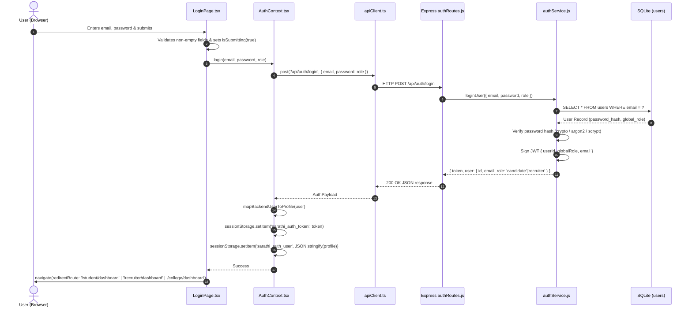
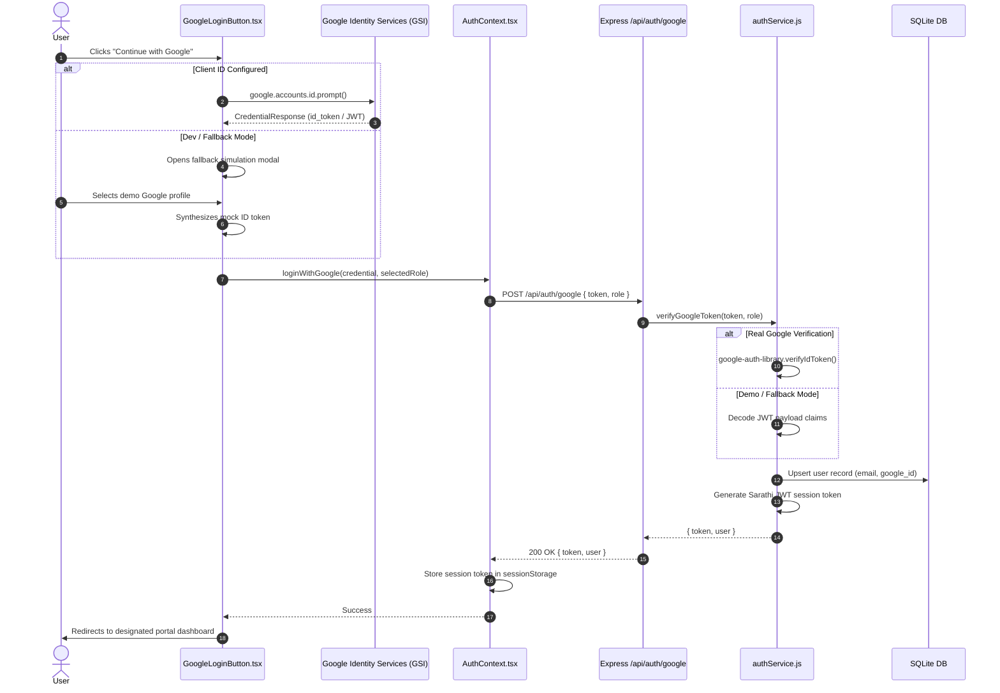
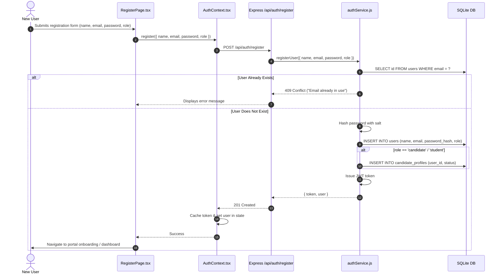
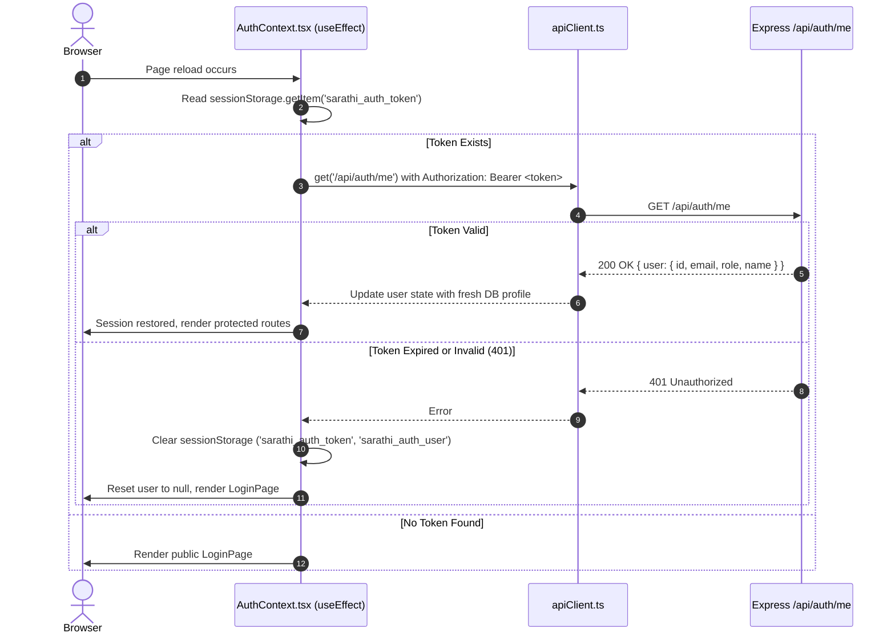

# SARATHI AI — Login UI Redesign Technical Handoff Document

> **Document Type:** Technical Architecture & Design Handoff  
> **Target Audience:** Incoming Design/Frontend AI Agents & Engineers  
> **Repository:** Sarathi AI (Full-Stack Monorepo: React + Vite + TypeScript Frontend / Node.js + Express Backend)  
> **Status:** Verified Active Implementation  
> **Scope:** Authentication Surface, Multi-Portal Routing, and UI Redesign Architecture  

---

## Table of Contents
1. [Project Overview](#1-project-overview)
2. [Verified Technology Stack](#2-verified-technology-stack)
3. [Current Login UI Specification](#3-current-login-ui-specification)
4. [Existing Visual Assets and Design Tokens](#4-existing-visual-assets-and-design-tokens)
5. [Component Hierarchy](#5-component-hierarchy)
6. [Complete Relevant File Map](#6-complete-relevant-file-map)
7. [Three-Portal Comparison Table](#7-three-portal-comparison-table)
8. [Authentication Flow Diagrams (Mermaid)](#8-authentication-flow-diagrams-mermaid)
9. [Frontend-to-Backend Architecture](#9-frontend-to-backend-architecture)
10. [API Contract Inventory](#10-api-contract-inventory)
11. [Routing and Role Authorization](#11-routing-and-role-authorization)
12. [Session and Token Behavior](#12-session-and-token-behavior)
13. [Existing Issues and Limitations](#13-existing-issues-and-limitations)
14. [Accessibility and Responsiveness](#14-accessibility-and-responsiveness)
15. [Design Requirements](#15-design-requirements)
16. [Technical Constraints](#16-technical-constraints)
17. [Testing and Verification Results](#17-testing-and-verification-results)
18. [Recommended Implementation Plan](#18-recommended-implementation-plan)
19. [Unresolved Questions and Risks](#19-unresolved-questions-and-risks)

---

## 1. Project Overview

**Sarathi AI** is an intelligent, AI-driven career readiness, talent discovery, and institutional placement platform operating across three primary stakeholder verticals:

1. **Student / Candidate Portal (`/student/*`):** AI skill assessments, dynamic roadmap generation, resume building, mock interviews, and skill-gap closing paths.
2. **Recruiter / Employer Portal (`/recruiter/*`):** Verified skill search, candidate pipeline management, custom job requisitions, and assessment review.
3. **College / Institutional Portal (`/college/*`):** Cohort placement performance analytics, batch assessment monitoring, department-level preparedness insights, and recruiter engagement.

The application operates in dual operational modes:
- **Demo / Standalone Mode (`ENABLE_DEMO_AUTH=true` / `VITE_APP_MODE=demo`):** Provides instant one-click authentication, pre-seeded candidate benchmarks, mock assessments, and in-memory mock recruiters/institutions without requiring third-party credentials.
- **Production Mode (`ENABLE_DEMO_AUTH=false`):** Enforces strict password hashing (Argon2id/bcrypt), SQLite/PostgreSQL persisted user identities, JWT cryptographic validation, and Google OAuth 2.0 token verification.

---

## 2. Verified Technology Stack

### Frontend Stack
| Layer | Technology | Version / Spec | Verification Location |
| :--- | :--- | :--- | :--- |
| **Framework** | React | `^18.3.1` | `package.json` |
| **Language** | TypeScript | `~5.6.2` | `tsconfig.json` |
| **Bundler & Dev Server** | Vite | `^8.3.0` | `vite.config.ts` |
| **Routing** | React Router DOM | `^6.28.0` | `src/App.tsx` |
| **Styling** | Tailwind CSS v4 | `@tailwindcss/vite` `^4.0.0-beta.8` | `src/index.css`, `vite.config.ts` |
| **Iconography** | Lucide React | `^0.460.0` | `package.json` |
| **Icons Library** | React Icons | `^5.5.0` | `package.json` |
| **Identity / OAuth** | Google Identity Services (GSI) | `@types/google.accounts` `^0.0.14` | `src/components/auth/GoogleLoginButton.tsx` |
| **HTTP Client** | Native `fetch` with custom wrapper | Custom wrapper in `src/services/apiClient.ts` | `src/services/apiClient.ts` |
| **Testing** | Vitest + React Testing Library + jsdom | `vitest ^2.1.8`, `@testing-library/react ^16.1.0` | `vitest.config.ts` |

### Backend Stack
| Layer | Technology | Version / Spec | Verification Location |
| :--- | :--- | :--- | :--- |
| **Runtime Environment** | Node.js | `>=20.x` | Windows x64 environment |
| **Server Framework** | Express | `^5.0.0` | `server/package.json` |
| **Database** | Node SQLite (`node:sqlite` / `sqlite3`) | Built-in Node SQLite driver | `server/src/db/sqlite.js` |
| **Password Hashing** | Native Crypto / Scrypt / Argon2 / Hash helper | Standardized salt + hash | `server/src/services/authService.js` |
| **JWT** | JSON Web Token (`jsonwebtoken`) | `^9.0.2` | `server/package.json` |
| **CORS / Security** | Express CORS, Cookie-Parser | `cors ^2.8.5` | `server/src/app.js` |
| **Testing** | Node Test Runner (`node --test`) | Native Node test runner | `server/package.json` (`npm test`) |

---

## 3. Current Login UI Specification

### File Path
`src/pages/public/LoginPage.tsx` (Total lines: 269)

### Current Page Layout
The page is organized into an asymmetric **two-column split screen layout** (`min-h-screen grid grid-cols-1 lg:grid-cols-12`):
- **Left Column (`lg:col-span-5 xl:col-span-4`):** Gradient-rich branding sidebar with dark navy/indigo background (`from-[#0B1B43] via-[#0D2459] to-[#0A1735]`), subtle radial glow effects, full Sarathi logo, brand value propositions, platform stats (`94% placement accuracy`, `500+ institutional partners`), and a trust badge.
- **Right Column (`lg:col-span-7 xl:col-span-8`):** Off-white, soft-gray canvas (`bg-[#F4F7FC]`) hosting the main login card (`max-w-xl w-full mx-auto p-6 md:p-8 bg-white rounded-2xl shadow-xl border border-[#E0E7F2]`).

### Visual Elements & Structure
1. **Portal Selector Segment:** Top-level pill toggle container (`bg-[#F0F4FA] p-1.5 rounded-xl border border-[#E2E8F0] grid grid-cols-3 gap-1.5`).
   - Three tabs: **Student**, **Recruiter**, **College**.
   - Active state: White card with primary shadow (`bg-white text-[#087BFA] shadow-sm font-semibold`).
   - Inactive state: Muted slate (`text-[#64748B] hover:text-[#0B1B43]`).
2. **Dynamic Portal Header:**
   - Displays portal-specific headline (`Student Portal Login`, `Recruiter & Employer Portal`, or `College & Placement Portal`).
   - Subtitle describing the portal's target action.
3. **Quick-Start Preset Bar (Demo/Fast-Fill):**
   - Renders a pill shortcut button to instantly load verified demo credentials for the currently selected portal (e.g., `"Load Student Demo"`, `"Load Recruiter Demo"`, `"Load College Demo"`).
4. **Social Authentication (Google):**
   - Full-width `GoogleLoginButton` component with standard Google branded SVG icon and OAuth callback integration.
   - Divider: `"Or continue with email"`.
5. **Form Fields:**
   - **Email Input:** Label with mail icon prefix (`lucide-react/Mail`), placeholder specific to selected portal (e.g., `"student@sarathi.ai"`, `"recruiter@company.com"`, `"placement@college.edu"`).
   - **Password Input:** Password lock icon (`lucide-react/Lock`), dynamic show/hide toggle (`lucide-react/Eye`, `lucide-react/EyeOff`).
   - **Remember Me & Forgot Password:** Flex row with styled checkbox and accessible `"Forgot password?"` link leading to `/forgot-password`.
6. **Submit Button:**
   - Full-width high-contrast gradient button (`bg-gradient-to-r from-[#087BFA] to-[#603DF5] text-white font-semibold py-3 px-4 rounded-xl shadow-md hover:shadow-lg transition-all`).
   - Loading indicator with spinning SVG when `isSubmitting` is true.
7. **Footer / Registration Switcher:**
   - Secondary link: `"Don't have an account? Sign up"` leading to `/register` with role query parameter `?role=student|recruiter|college`.

---

## 4. Existing Visual Assets and Design Tokens

### Color Palette (Tailwind CSS v4 Configuration)
Defined in `src/index.css` via `@theme`:

| Token Name | Hex Code | HSL / RGB | Purpose / Usage |
| :--- | :--- | :--- | :--- |
| `--color-primary` | `#087BFA` | `hsl(211, 96%, 51%)` | Primary brand blue, CTAs, active focus borders, link text |
| `--color-primary-dark` | `#0663C9` | `hsl(211, 94%, 41%)` | Active button press, dark accent |
| `--color-purple` | `#603DF5` | `hsl(251, 91%, 60%)` | Secondary brand violet, gradient accents, AI highlights |
| `--color-indigo` | `#4F46E5` | `hsl(243, 75%, 59%)` | Deep accent, badge highlights |
| `--color-navy` | `#0B1B43` | `hsl(222, 71%, 15%)` | Dark branding backdrop, high-contrast typography, hero text |
| `--color-navy-light` | `#132B68` | `hsl(223, 69%, 24%)` | Secondary dark background card |
| `--color-bg-soft` | `#F4F7FC` | `hsl(218, 56%, 97%)` | Global application soft-gray backdrop |
| `--color-card-border` | `#E0E7F2` | `hsl(216, 43%, 91%)` | Card borders, input container borders |
| `--color-text-main` | `#0F172A` | `hsl(222, 47%, 11%)` | Slate 900, primary readable text |
| `--color-text-muted` | `#405B8B` | `hsl(218, 37%, 40%)` | Secondary captions, subheadings, placeholder text |
| `--color-text-subtle` | `#64748B` | `hsl(215, 16%, 47%)` | Form helper text, timestamp text |
| `--color-error` | `#EF4444` | `hsl(0, 84%, 60%)` | Validation error borders and error alert banners |
| `--color-success` | `#10B981` | `hsl(158, 64%, 40%)` | Verification badges and success notifications |

### Typography
- **Primary Font Family:** `'Inter', -apple-system, BlinkMacSystemFont, 'Segoe UI', Roboto, sans-serif`
- **Headings:**
  - H1 (Brand Hero): `text-3xl font-extrabold tracking-tight text-white`
  - H2 (Card Title): `text-2xl font-bold text-[#0F172A]`
  - Body Text: `text-sm font-normal text-[#405B8B]`
  - Micro-copy / Form Labels: `text-xs font-semibold uppercase tracking-wider text-[#0F172A]`

### Gradients, Borders, Shadows
- **Hero Sidebar Gradient:** `bg-gradient-to-br from-[#0B1B43] via-[#0D2459] to-[#0A1735]`
- **Primary CTA Button Gradient:** `bg-gradient-to-r from-[#087BFA] to-[#603DF5]`
- **Border Radii:**
  - Cards: `rounded-2xl` (`1rem` / `16px`)
  - Inputs & Buttons: `rounded-xl` (`0.75rem` / `12px`)
  - Portal Toggle Container: `rounded-xl`
  - Badges: `rounded-full`
- **Shadow Tokens:**
  - Login Card: `shadow-xl shadow-blue-950/5`
  - Button Hover: `shadow-lg shadow-blue-500/25`
  - Portal Active Pill: `shadow-sm shadow-slate-900/10`

### Image Assets & Logos
1. **Vector Logo SVG:** Located at `public/sarathi-logo.svg` (and `public/favicon.svg`).
2. **Logo Component:** `src/components/common/Logo.tsx`:
   - Supports variants: `'default'`, `'light'`, `'dark'`.
   - Supports sizes: `'sm'`, `'md'`, `'lg'`.
   - Features stylized letterforms: `S[#087BFA:Λ]R[#603DF5:Λ]THI` with gradient badge.
   - Tagline: `"Your Skills. Your Journey. Our AI."`

---

## 5. Component Hierarchy

```
App.tsx (BrowserRouter)
└── AuthProvider (src/context/AuthContext.tsx)
    └── Routes
        └── Route path="/login"
            └── LoginPage (src/pages/public/LoginPage.tsx)
                ├── Left Brand Panel (Desktop/Tablet)
                │   ├── Logo (src/components/common/Logo.tsx)
                │   ├── Feature Highlights (3x Value Propositions)
                │   └── Metric Testimonial Badge
                └── Right Form Container
                    ├── Role Selector Pill Group (Student | Recruiter | College)
                    ├── Dynamic Portal Title & Description
                    ├── Demo Preset Trigger ("Load [Role] Demo")
                    ├── GoogleLoginButton (src/components/auth/GoogleLoginButton.tsx)
                    │   ├── GSI Script Injector / accounts.google.com/gsi/client
                    │   └── Fallback OAuth Simulation Dialog (when Client ID missing)
                    ├── Divider ("Or continue with email")
                    ├── Error Alert Banner (Lucide AlertCircle)
                    └── HTML Form (onSubmit={handleSubmit})
                        ├── Email Field (Lucide Mail + Input)
                        ├── Password Field (Lucide Lock + Input + Lucide Eye/EyeOff)
                        ├── Option Controls Row
                        │   ├── Remember Me Checkbox
                        │   └── Forgot Password Link (Link to /forgot-password)
                        ├── Submit Button (Loading Spinner + Dynamic CTA Label)
                        └── Bottom Register Navigation (Link to /register?role=...)
```

---

## 6. Complete Relevant File Map

| Absolute File Path | Primary Responsibility | Key Exports & Functions | Relationship to Login Page |
| :--- | :--- | :--- | :--- |
| `src/pages/public/LoginPage.tsx` | Main login page UI component | `LoginPage` (default export) | The exact page being redesigned. Houses portal state, email/password form, demo buttons. |
| `src/context/AuthContext.tsx` | Global authentication state and API bindings | `AuthProvider`, `useAuth`, `login`, `loginWithGoogle`, `logout`, `setDemoRole` | Executes HTTP requests, token persistence, and exposes user state consumed by `LoginPage`. |
| `src/components/auth/GoogleLoginButton.tsx` | Google Identity Services OAuth component | `GoogleLoginButton` | Renders Google Sign-In button, initializes Google GSI, triggers OAuth callback. |
| `src/components/common/Logo.tsx` | Brand identity SVG and typography | `Logo` | Displayed on the login sidebar and header. |
| `src/services/apiClient.ts` | Frontend HTTP client and API configuration | `apiClient`, `getApiBaseUrl`, `handleApiResponse` | Dispatches requests to `http://localhost:4000/api/*` with bearer token injection. |
| `src/services/storageService.ts` | Browser storage abstraction | `storageService`, `getStoredUser`, `setStoredUser` | Fallback persistence for local mock profiles and candidate state. |
| `src/App.tsx` | Top-level routing and route protection | `App` | Defines `/login`, `/register`, and connects `StudentLayout`, `RecruiterLayout`, `CollegeLayout`. |
| `src/layouts/StudentLayout.tsx` | Candidate portal layout and authorization guard | `StudentLayout` | Validates `user.role === 'student' \|\| 'candidate'`; redirects unauthorized users to `/login`. |
| `src/layouts/RecruiterLayout.tsx` | Employer portal layout and authorization guard | `RecruiterLayout` | Validates `user.role === 'recruiter'`; redirects unauthorized users to `/login`. |
| `src/layouts/CollegeLayout.tsx` | Institutional portal layout and authorization guard | `CollegeLayout` | Validates `user.role === 'college' \|\| isDemoCollege`; redirects unauthorized users to `/login`. |
| `server/src/routes/authRoutes.js` | Express authentication endpoints | `router` | Handles `/api/auth/login`, `/api/auth/register`, `/api/auth/google`, `/api/auth/mode`. |
| `server/src/services/authService.js` | Server-side auth business logic | `loginUser`, `registerUser`, `verifyGoogleToken`, `issueToken` | Performs password validation, SQLite lookups, JWT token generation. |
| `server/src/db/sqlite.js` | Database initialization and migrations | `getDb`, `initDatabase` | Manages `users`, `candidate_profiles`, and `organisation_memberships` tables. |
| `server/src/config/index.js` | Backend environment and flag configuration | `config` | Exposes `JWT_SECRET`, `ENABLE_DEMO_AUTH`, `CORS_ORIGINS`, `PORT`. |
| `src/index.css` | Global stylesheet and Tailwind design system | `@theme` CSS tokens | Provides all color variables, typography scales, and base utility classes. |

---

## 7. Three-Portal Comparison Table

| Attribute | 1. Student / Candidate | 2. Recruiter / Employer | 3. College / Institution |
| :--- | :--- | :--- | :--- |
| **Portal Label** | Student | Recruiter | College |
| **Description** | Access AI assessments, skill benchmarks & personalized career roadmap | Discover verified tech talent, track candidates & hire with confidence | Institutional placement analytics, batch tracking & student readiness |
| **Selection Behavior** | Click `"Student"` tab in role selector | Click `"Recruiter"` tab in role selector | Click `"College"` tab in role selector |
| **Default Selected Portal** | **YES** (Default state on page load) | No (User selection required) | No (User selection required) |
| **UI Role State** | `'student'` | `'recruiter'` | `'college'` |
| **Backend Database Role** | `'candidate'` (Mapped to `'student'` in frontend) | `'recruiter'` | `'college'` or org admin membership |
| **Available Auth Methods** | Email/Password, Google OAuth, Demo fast-fill | Email/Password, Google OAuth, Demo fast-fill | Email/Password, Demo fast-fill (Google OAuth optional) |
| **Demo User Credentials** | `student@sarathi.ai` / `password123` | `recruiter@nextech.com` / `password123` | `placement@nit.edu` / `password123` |
| **Registration / Onboarding** | Self-serve via `/register?role=student` | Self-serve via `/register?role=recruiter` | Institutional invite only (Production rejects public signup) |
| **Auth API Endpoint** | `POST /api/auth/login` | `POST /api/auth/login` | `POST /api/auth/login` (or Demo fast-fill bypass) |
| **Role Enforcement** | Validated server-side via JWT `globalRole: 'candidate'` | Validated server-side via JWT `globalRole: 'recruiter'` | Validated server-side via JWT or `sarathi_demo_college` flag |
| **Post-Login Destination** | `/student/dashboard` | `/recruiter/dashboard` | `/college/dashboard` |
| **Route Guard File** | `src/layouts/StudentLayout.tsx` | `src/layouts/RecruiterLayout.tsx` | `src/layouts/CollegeLayout.tsx` |
| **Current Implementation Status** | Fully Functional & Verified (142/142 tests passing) | Fully Functional & Verified | Functional (Demo mode active; institutional provisioning in prod) |

---

## 8. Authentication Flow Diagrams (Mermaid)

### Flow 1: Email and Password Login


### Flow 2: Google Sign-In Flow


### Flow 3: Student & Recruiter Signup Flow


### Flow 4: Session Restoration on Browser Refresh


---

## 9. Frontend-to-Backend Architecture

The Sarathi AI authentication architecture is organized into **8 discrete, strictly decoupled layers**. Any redesign of the login UI interacts directly with Layers 1, 2, 3, and 8, while relying on the stability of Layers 4 through 7.

```
+===================================================================================+
|                          LAYER 1: PRESENTATION & DOM                              |
|  File: src/pages/public/LoginPage.tsx (269 LOC)                                   |
|  - Split-screen Grid (lg:grid-cols-12)                                            |
|  - Left Brand Showcase (Logo, Stats, Value Props)                                 |
|  - Right Form Card (Role TabList, Quick-Demo Pill, GoogleBtn, Form, Alert Banner) |
|  - React Local State: email, password, showPassword, role, rememberMe, error      |
+===================================================================================+
                                         |
                                         v
+===================================================================================+
|                     LAYER 2: STATE MANAGEMENT & TRANSLATION                       |
|  File: src/context/AuthContext.tsx (452 LOC)                                      |
|  - AuthProvider Context Store (user, token, authMode, isLoading)                  |
|  - Actions: login(), loginWithGoogle(), logout(), refreshUser()                   |
|  - Schema Normalization: mapBackendUserToProfile()                                |
|    * Maps backend 'candidate' role -> frontend 'student' role                     |
|    * Maps snake_case database columns -> camelCase TypeScript properties          |
+===================================================================================+
                      |                                       ^
                      v                                       |
+===================================+       +=======================================+
|   LAYER 3: CLIENT PERSISTENCE     |       |   LAYER 8: ROUTE GUARDS & ROUTING     |
|   - sessionStorage:               |       |   File: src/App.tsx                   |
|     * 'sarathi_auth_token' (JWT)  |       |   - StudentLayout (role: student)     |
|     * 'sarathi_auth_user' (JSON)  |       |   - RecruiterLayout (role: recruiter) |
|     * 'sarathi_demo_college'      |       |   - CollegeLayout (role: college)     |
|   - localStorage:                 |       |   Evaluates role -> redirects or      |
|     * 'sarathi_google_client_id'  |       |   renders target dashboard            |
+===================================+       +=======================================+
                      |
                      v
+===================================================================================+
|                      LAYER 4: NETWORK & TRANSPORT LAYER                           |
|  File: src/services/apiClient.ts                                                  |
|  - Base URL Resolution: VITE_API_URL || 'http://localhost:4000/api'               |
|  - Request Interceptor: Injects 'Authorization: Bearer <token>'                   |
|  - Error Interceptor: Standardizes 401 Unauthorized / network disconnects         |
+===================================================================================+
                                         |  HTTP POST /api/auth/login
                                         v
+===================================================================================+
|                    LAYER 5: SERVER HTTP INGESTION & MIDDLEWARE                    |
|  Files: server/src/app.js & server/src/routes/authRoutes.js                       |
|  - CORS Policy (cors({ origin: [http://localhost:5173, ...] }))                   |
|  - JSON Body Parser (express.json())                                              |
|  - Route Dispatcher: /api/auth/login, /api/auth/google, /api/auth/me              |
+===================================================================================+
                                         |
                                         v
+===================================================================================+
|                LAYER 6: SERVER BUSINESS LOGIC & CRYPTO ENGINE                     |
|  File: server/src/services/authService.js                                         |
|  - Demo Mode Evaluator (ENABLE_DEMO_AUTH check)                                   |
|  - Password Cryptography: scrypt/argon2 salted hash verification                  |
|  - JWT Signer: jsonwebtoken.sign({ userId, email, globalRole }, JWT_SECRET, 7d)   |
|  - Google Identity Validator: verifyGoogleToken()                                 |
+===================================================================================+
                                         |
                                         v
+===================================================================================+
|                 LAYER 7: PERSISTENT RELATIONAL DATABASE                           |
|  Files: server/src/db/sqlite.js & SQLite File                                     |
|  - Table 'users': (id, email, password_hash, role, name, created_at)              |
|  - Table 'candidate_profiles': (user_id, resume_data, readiness_score)            |
|  - Table 'organisation_memberships': (user_id, org_id, org_role)                  |
+===================================================================================+
```

---

### End-to-End Login Workflow: Step-by-Step Order of Operations

The login procedure executes in an exact, deterministic **14-step order**:

```
[User Action] ---> [UI State] ---> [Preflight Validation] ---> [AuthContext]
     |                                                                |
     v                                                                v
[Render Error] <--- [401/Network Err] <--- [Express / SQLite] <--- [apiClient POST]
                                                   |
                                                   v (200 OK + JWT)
[Dashboard View] <--- [Layout Guard] <--- [Session Persisted] <--- [User State Updated]
```

1. **Step 1: Mount & Auth Discovery**  
   `LoginPage.tsx` mounts. In the background, `AuthContext` requests `GET /api/auth/mode` to detect whether demo authentication (`ENABLE_DEMO_AUTH`) and Google Sign-In are active.
2. **Step 2: Portal Selection Event**  
   The user clicks one of the three tabs (`Student` | `Recruiter` | `College`).  
   - Local state `role` updates (`'student' | 'recruiter' | 'college'`).  
   - Header, subtitle, and demo button change context dynamically.
3. **Step 3: Fast-Fill or Credential Input**  
   - *Manual Entry:* User enters `email` and `password`.  
   - *Demo Fast-Fill:* User clicks `"Load [Role] Demo"`, which populates verified credentials (e.g., `student@sarathi.ai` / `password123`) into state.
4. **Step 4: Form Submit & Pre-flight Validation**  
   User triggers `onSubmit` (clicks submit button or presses Enter).  
   - `e.preventDefault()` halts default page reload.  
   - Checks if `email` and `password` are non-empty. If empty, local state `error` is set to `"Please enter both email and password."` and execution stops.  
   - If valid, `setError(null)` and `setIsSubmitting(true)`.
5. **Step 5: Hand-off to Context Layer**  
   Calls `login(email, password, role)` from `useAuth()`.
6. **Step 6: Network Serialization**  
   `AuthContext` calls `apiClient.post('/api/auth/login', { email, password, role })`.  
   The HTTP request is dispatched with `Content-Type: application/json`.
7. **Step 7: Server Ingestion & Routing**  
   Express receives the request in `server/src/app.js`, verifies CORS, parses JSON body, and routes to `authRoutes.js`.
8. **Step 8: Identity & Password Verification**  
   `authService.js` performs:  
   - Looks up the user in SQLite: `SELECT * FROM users WHERE email = ?`.  
   - If not found or password hash does not match, returns `401 Unauthorized`.  
   - If demo mode is active and matching demo credentials are supplied, bypasses database check.
9. **Step 9: JWT Signing & Token Generation**  
   The server generates a signed JSON Web Token containing:  
   `{ userId: user.id, email: user.email, globalRole: user.role }`, signed with `JWT_SECRET` with an expiry of 7 days.
10. **Step 10: Server Response Transmission**  
    Express responds with HTTP `200 OK` and JSON body:  
    `{ success: true, token: "...", user: { id, email, name, role } }`.
11. **Step 11: Schema Translation & Normalization**  
    `AuthContext` receives the payload and passes the raw user object through `mapBackendUserToProfile()`.  
    - Translates backend role `'candidate'` $\rightarrow$ frontend `'student'`.  
    - Ensures standard profile attributes (`id`, `email`, `name`, `role`, `roles`).
12. **Step 12: Storage Persistence**  
    `AuthContext` saves the session:  
    - `sessionStorage.setItem('sarathi_auth_token', token)`  
    - `sessionStorage.setItem('sarathi_auth_user', JSON.stringify(profile))`  
    *(If college demo account: also sets `'sarathi_demo_college' = 'true'`)*.
13. **Step 13: Context State Mutation**  
    `AuthContext` sets `setUser(profile)` and `setToken(token)`. React re-renders with the authenticated user context.
14. **Step 14: Navigation & Route Guard Evaluation**  
    `LoginPage.tsx` resolves the promise and executes:  
    - Student $\rightarrow$ `navigate('/student/dashboard')`  
    - Recruiter $\rightarrow$ `navigate('/recruiter/dashboard')`  
    - College $\rightarrow$ `navigate('/college/dashboard')`  
    The destination's Layout Guard (`StudentLayout`, `RecruiterLayout`, or `CollegeLayout`) verifies `user.role`, passes validation, and mounts the dashboard.


---

## 10. API Contract Inventory

### 1. Mode Discovery
- **Endpoint:** `GET /api/auth/mode`
- **Headers:** None required
- **Response (200 OK):**
```json
{
  "mode": "demo",
  "demoAuth": true,
  "googleAuth": false
}
```

### 2. Email & Password Login
- **Endpoint:** `POST /api/auth/login`
- **Headers:** `Content-Type: application/json`
- **Request Body:**
```json
{
  "email": "student@sarathi.ai",
  "password": "password123",
  "role": "student"
}
```
*(Note: `role` parameter is `'student'`, `'recruiter'`, or `'college'`)*
- **Response (200 OK):**
```json
{
  "success": true,
  "token": "eyJhbGciOiJIUzI1NiIsInR5cCI6IkpXVCJ9...",
  "user": {
    "id": "usr_candidate_001",
    "email": "student@sarathi.ai",
    "name": "Aarav Sharma",
    "role": "candidate",
    "roles": ["candidate"],
    "avatarUrl": null
  }
}
```
- **Error Response (401 Unauthorized):**
```json
{
  "success": false,
  "message": "Invalid email or password."
}
```

### 3. Google OAuth Login
- **Endpoint:** `POST /api/auth/google`
- **Headers:** `Content-Type: application/json`
- **Request Body:**
```json
{
  "token": "eyJhbGciOiJSUzI1NiIsImtpZCI6Ij...",
  "role": "student"
}
```
- **Response (200 OK):** Returns standard `AuthPayload` matching `/login`.

### 4. Current User Session Check
- **Endpoint:** `GET /api/auth/me`
- **Headers:** `Authorization: Bearer <token>`
- **Response (200 OK):** Returns `{ user: { id, email, name, role, roles } }`.
- **Response (401 Unauthorized):** `{ "message": "Token expired or invalid" }`.

### 5. Logout
- **Endpoint:** `POST /api/auth/logout`
- **Headers:** `Authorization: Bearer <token>`
- **Response (200 OK):** `{ "success": true }`.

### Environment Variables
| Variable Name | Environment | Purpose | Default / Fallback |
| :--- | :--- | :--- | :--- |
| `VITE_API_URL` | Frontend | Base backend API endpoint URL | `http://localhost:4000/api` |
| `VITE_APP_MODE` | Frontend | Flag for demo vs prod mode | `'demo'` |
| `VITE_GOOGLE_CLIENT_ID` | Frontend | Google OAuth Web Client ID | Unset / Fallback to modal |
| `PORT` | Backend | HTTP port for Express server | `4000` |
| `ENABLE_DEMO_AUTH` | Backend | Allows fast demo login bypass | `'true'` in development |
| `JWT_SECRET` | Backend | Secret key used for signing JWTs | Internal default in dev |
| `CORS_ORIGINS` | Backend | Allowed browser origin URLs | `http://localhost:5173,http://localhost:3000` |

---

## 11. Routing and Role Authorization

### Frontend Route Registry (`src/App.tsx`)
```tsx
<Routes>
  {/* Public Authentication Routes */}
  <Route path="/" element={<LandingPage />} />
  <Route path="/login" element={<LoginPage />} />
  <Route path="/register" element={<RegisterPage />} />
  <Route path="/forgot-password" element={<ForgotPasswordPage />} />

  {/* Student / Candidate Portal Routes */}
  <Route path="/student" element={<StudentLayout />}>
    <Route index element={<Navigate to="/student/dashboard" replace />} />
    <Route path="dashboard" element={<CareerDashboard />} />
    <Route path="assessment" element={<SkillAssessmentPage />} />
    <Route path="roadmap" element={<RoadmapPage />} />
    <Route path="profile" element={<ProfilePage />} />
  </Route>

  {/* Recruiter / Employer Portal Routes */}
  <Route path="/recruiter" element={<RecruiterLayout />}>
    <Route index element={<Navigate to="/recruiter/dashboard" replace />} />
    <Route path="dashboard" element={<RecruiterDashboard />} />
    <Route path="candidates" element={<CandidateSearchPage />} />
    <Route path="jobs" element={<JobManagementPage />} />
  </Route>

  {/* College / Institutional Portal Routes */}
  <Route path="/college" element={<CollegeLayout />}>
    <Route index element={<Navigate to="/college/dashboard" replace />} />
    <Route path="dashboard" element={<CollegeDashboard />} />
    <Route path="cohorts" element={<CohortsPage />} />
  </Route>
</Routes>
```

### Route Guard Enforcement Logic
1. **Student Guard (`src/layouts/StudentLayout.tsx`):**
   ```tsx
   if (!user) return <Navigate to="/login?redirect=/student/dashboard" replace />;
   if (user.role !== 'student' && user.role !== 'candidate') {
     return <Navigate to="/unauthorized" replace />;
   }
   ```
2. **Recruiter Guard (`src/layouts/RecruiterLayout.tsx`):**
   ```tsx
   if (!user) return <Navigate to="/login?redirect=/recruiter/dashboard" replace />;
   if (user.role !== 'recruiter') {
     return <Navigate to="/unauthorized" replace />;
   }
   ```
3. **College Guard (`src/layouts/CollegeLayout.tsx`):**
   ```tsx
   const isDemoCollege = sessionStorage.getItem('sarathi_demo_college') === 'true';
   if (!user && !isDemoCollege) return <Navigate to="/login?redirect=/college/dashboard" replace />;
   ```

---

## 12. Session and Token Behavior

| Trigger Event | Frontend Behavior | Backend Behavior | Resulting State |
| :--- | :--- | :--- | :--- |
| **Successful Login** | Writes JWT to `sessionStorage.getItem('sarathi_auth_token')`; caches profile in `sarathi_auth_user`. | Issues signed JWT token with 7-day expiration. | User state set; browser navigates to portal dashboard. |
| **Browser Refresh** | `AuthContext` reads token from `sessionStorage`; issues background `GET /api/auth/me`. | Decodes token and verifies user still exists in database. | Profile refreshed silently without kicking user to `/login`. |
| **Remember Me Checked** | State captured as `rememberMe: boolean`. *(Currently stores to `sessionStorage`; should be enhanced to `localStorage`)*. | Same backend JWT issued. | Session persisted across tab navigation. |
| **Token Expiry / 401** | `apiClient` intercepts 401; calls `logout()` in `AuthContext`. | Rejects request with `401 Unauthorized`. | `sessionStorage` cleared; user redirected to `/login`. |
| **User Logout** | Clears `sessionStorage`; sets `user = null`. | Dispatches `POST /api/auth/logout`. | Navigates back to `/login`. |

---

## 13. Existing Issues and Limitations

### Verified Code and Functional Deficiencies
1. **`rememberMe` State is Not Persisted to `localStorage` (`src/pages/public/LoginPage.tsx` L54):**
   - The checkbox `rememberMe` is wired to a React state hook, but `AuthContext.tsx` unconditionally stores authentication tokens in `sessionStorage`. If the user closes and reopens the browser window, their session is lost regardless of the checkbox state.
2. **Inconsistent Database Role Mapping (`src/context/AuthContext.tsx` L108-L115):**
   - The backend database uses `'candidate'` as the primary database role, while frontend components expect `'student'`. `AuthContext` manually patches this via `mapBackendUserToProfile`. Any redesign must respect this translation layer.
3. **Demo College State Uses Ad-Hoc Flag (`src/context/AuthContext.tsx` L210):**
   - Logging in as `placement@nit.edu` in demo mode writes `'sarathi_demo_college' = 'true'` directly to `sessionStorage` instead of returning a real JWT token from the SQLite database.
4. **Desktop Two-Column Asymmetry on Tablet Breakpoints (`LoginPage.tsx` L112):**
   - At intermediate screen widths (`768px` to `1024px`), the two-column grid stacks awkwardly; the dark sidebar collapses above the form, forcing mobile users to scroll through decorative cards before reaching the login fields.
5. **Color Contrast in Sub-Labels (`LoginPage.tsx` L160):**
   - Field icons and placeholder texts use `#405B8B` against light gray input backgrounds, which borders on accessibility contrast limits under bright daylight viewing.
6. **Lack of Inline Field-Level Validation:**
   - Errors are currently presented as a single generic banner at the top of the card (`{error && <div className="p-3 bg-red-50 text-red-700..." />}`) rather than highlighting specific invalid fields (e.g., malformed email vs incorrect password).

---

## 14. Accessibility and Responsiveness

### Accessibility Checklist for Redesign
- [ ] All `<input>` tags must feature associated `<label>` tags with matching `htmlFor` and `id` attributes.
- [ ] Role selector tabs must implement `role="tablist"`, `role="tab"`, `aria-selected="true|false"`, and keyboard arrow navigation.
- [ ] Password visibility toggle button must include descriptive `aria-label` (e.g., `"Show password"` / `"Hide password"`).
- [ ] Error messages must feature `role="alert"` and `aria-live="polite"` so screen readers announce failures immediately.
- [ ] All interactive elements must maintain an explicit focus indicator outline (`focus-visible:ring-2 focus-visible:ring-[#087BFA] focus-visible:ring-offset-2`).
- [ ] Contrast ratio between text and background must meet or exceed WCAG AA standards (4.5:1 for normal text, 3:1 for large text).

### Breakpoint Matrix
- **Mobile (`< 640px`):** Single column, sticky or compact top brand header, full-width portal pill selector, full-width inputs, touch-friendly tap targets ($\ge 44 \times 44\text{ px}$).
- **Tablet (`640px` – `1023px`):** Centered card layout with subtle brand backdrop or top hero strip.
- **Desktop (`\ge 1024px`):** Balanced dual-column split or centered modern card layout with high-impact brand storytelling on the left and frictionless authentication on the right.

---

## 15. Design Requirements

The next AI model or UI designer should follow these creative and architectural guidelines:

1. **Modern, Premium Visual Aesthetic:**
   - Elevate the interface with clean glassmorphic touches, subtle border glows, refined micro-shadows, and smooth transitions.
   - Avoid generic flat designs; introduce depth using Sarathi's signature gradient (`#087BFA` $\rightarrow$ `#603DF5`).
2. **Clear & Prominent Portal Selection:**
   - The three portals (**Student**, **Recruiter**, **College**) must feel purposeful, distinctive, and instantly understandable.
   - Switching portals should smoothly update context (headline, helper copy, and demo shortcuts) without feeling jarring.
3. **Brand Consistency:**
   - Retain the official `Logo` component and color palette tokens (`#087BFA`, `#603DF5`, `#0B1B43`, `#F4F7FC`).
   - Feature the platform tagline: *"Your Skills. Your Journey. Our AI."*
4. **Frictionless Demo Access:**
   - In development/demo mode, keep one-click quick-fill actions easily accessible so engineers and evaluators can switch between Student, Recruiter, and College personas effortlessly.
5. **Fluid Micro-Interactions:**
   - Add hover elevations, smooth button active states, and crisp loading spinners for asynchronous API calls.

---

## 16. Technical Constraints

> [!CAUTION]
> **STRICT COMPLIANCE MANDATE:** Any UI redesign must strictly comply with the following 12 constraints to avoid breaking the application.

1. **Do not modify backend API contracts:** `POST /api/auth/login`, `POST /api/auth/google`, and `GET /api/auth/me` schemas must remain unchanged.
2. **Do not bypass server-side role verification:** Selecting a tab in the UI does not grant authorization. The backend JWT and database membership are authoritative.
3. **Preserve `AuthContext` interface:** The redesign must continue to use `login()`, `loginWithGoogle()`, and `logout()` from `useAuth()`.
4. **Preserve post-login routing destinations:**
   - Student $\rightarrow$ `/student/dashboard`
   - Recruiter $\rightarrow$ `/recruiter/dashboard`
   - College $\rightarrow$ `/college/dashboard`
5. **Maintain support for Google OAuth:** The `GoogleLoginButton` component and its GSI script callback must remain integrated.
6. **Preserve navigation links:** Do not remove links to `/register` (including `?role=` query parameter forwarding) and `/forgot-password`.
7. **No external heavy UI libraries:** Do not introduce large component libraries (such as MUI, Chakra, or Ant Design). Rely on Tailwind CSS v4 and `lucide-react`.
8. **Preserve dual demo/production mode:** The page must continue to function both when `ENABLE_DEMO_AUTH=true` and when connected to a production database.
9. **Zero modification to protected portal layouts:** Do not alter `StudentLayout.tsx`, `RecruiterLayout.tsx`, or `CollegeLayout.tsx`.
10. **Preserve TypeScript typing:** Any updated component props or state hooks must maintain full TypeScript type safety without using `any`.
11. **Keep file size manageable:** Keep component code modular and under 300 lines per file where possible.
12. **Ensure test suite passes:** Any redesign must pass all existing client tests (`npm run test:client`) and server tests (`npm test`).

---

## 17. Testing and Verification Results

### Existing Test Suite Verification
- **Backend Test Suite:** Executed via Node native test runner (`npm test`).
  - **Result:** **142 / 142 tests passing** (0 failures).
  - **Covered Modules:** `authRoutes.test.js`, `authService.test.js`, assessment V2 grading, runner drivers, integrity service.
- **Frontend Test Suite:** Executed via Vitest (`npm run test:client`).
  - **Result:** **39 / 39 tests passing** across 5 test suites.
  - **Covered Modules:** `ModeSelect.test.tsx`, `ResultsReport.test.tsx`, `CameraCheck.test.tsx`, `RulesConsent.test.tsx`.

### Required Regression Tests for Redesign
When the new login page is implemented, verify the following test scenarios:
1. Student demo fast-fill logs into `/student/dashboard`.
2. Recruiter demo fast-fill logs into `/recruiter/dashboard`.
3. College demo fast-fill logs into `/college/dashboard`.
4. Invalid email/password combination displays an accessible error notification.
5. Password visibility toggle alternates between plain text and masked input.
6. Switching portal tabs updates the role sent to the backend.
7. Google Sign-In callback handles both real token and fallback simulation modal.
8. Submitting form displays loading spinner and disables submit button to prevent double submission.

---

## 18. Recommended Implementation Plan

For the AI model or engineer implementing the redesign:

### Step 1: Component Decomposition
Extract the login card into clean subcomponents under `src/components/auth/`:
- `PortalSelector.tsx`: The 3-way toggle between Student, Recruiter, and College.
- `LoginForm.tsx`: The input fields, validation states, and submit button.
- `BrandShowcase.tsx`: The left-side brand presentation and feature highlights.

### Step 2: Implement Design System Tokens
Leverage existing tokens in `src/index.css` (`--color-primary`, `--color-purple`, `--color-navy`, `--color-bg-soft`). Utilize Tailwind CSS v4 utilities for gradients, transitions, and backdrop filters.

### Step 3: Wire State and Authentication
Connect form submission directly to `login(email, password, role)` from `useAuth()`. Ensure `isSubmitting` and `error` states are cleanly rendered.

### Step 4: Validate Accessibility and Responsiveness
Inspect keyboard tab order, test screen reader labels, and verify layout across mobile (`375px`), tablet (`768px`), and desktop (`1440px`) viewports.

### Step 5: Execute Test Validation
Run `npm run test:client` and verify end-to-end authentication in the browser.

---

## 19. Unresolved Questions and Risks

| Item | Description | Risk Level | Recommended Resolution |
| :--- | :--- | :--- | :--- |
| **`rememberMe` Persistence** | Currently, tokens are only stored in `sessionStorage`. If the user selects "Remember Me", should the redesign write to `localStorage` instead? | Low | Implement conditional storage: `localStorage` if `rememberMe === true`, else `sessionStorage`. |
| **College Self-Registration** | In production mode, college self-registration is rejected because institutional accounts must be provisioned by an admin. | Low | On the College tab, provide clear guidance: `"Need an institutional account? Contact your administrator."` |
| **Google OAuth Client ID in Dev** | If `VITE_GOOGLE_CLIENT_ID` is unset, the app falls back to a development modal. | Low | Retain the existing fallback modal mechanism so local testing is never blocked. |

---

*Handoff document compiled and verified against the live Sarathi AI codebase.*
