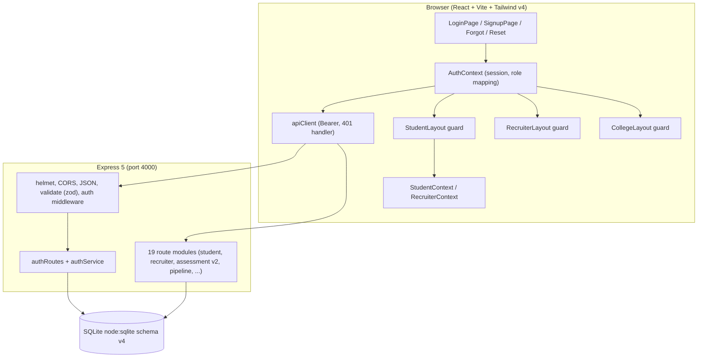
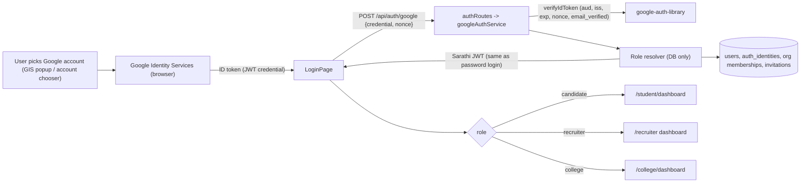
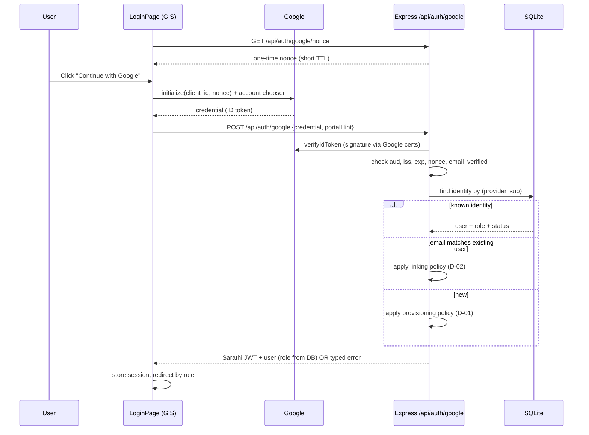
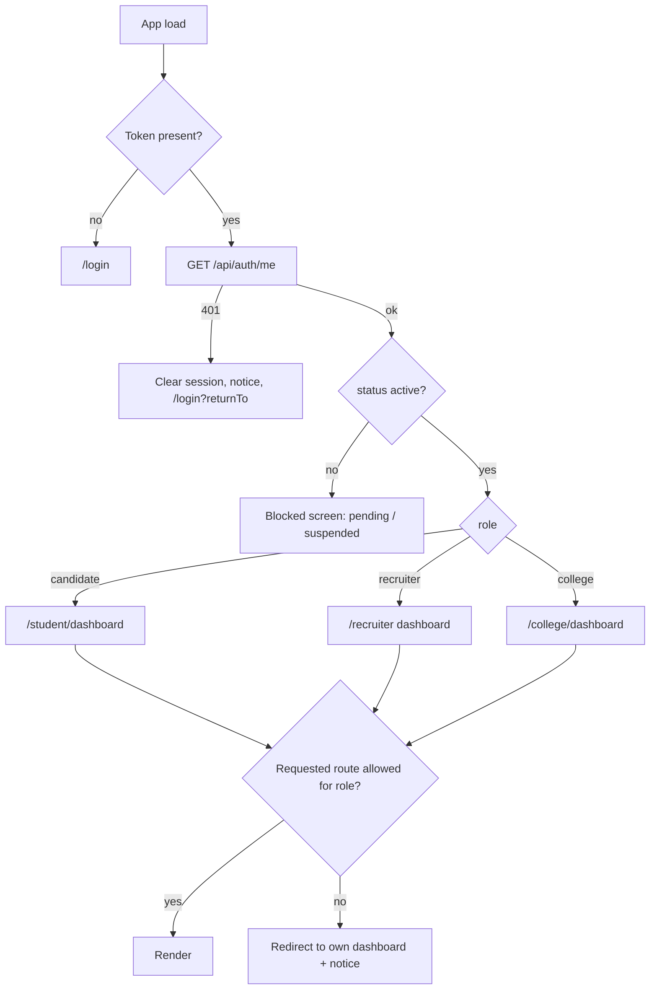

# 1. Document Title and Version

**Title:** SARATHI AI — Complete Product Requirements Document (Login Page, Three-Portal Integration, Google SSO, and System-Wide Connectivity)
**Filename:** `SARATHI_AI_COMPLETE_PRD.md`
**Version:** 1.0 (Draft for owner approval)
**Date:** 18 October 2026
**Status:** Implementation-ready, with open decisions listed in Section 30.

## 1.1 Evidence base and honesty statement

This PRD was written from six supplied documents only. **No source code, test run, or repository was accessible while writing it.** Every statement about the current system is therefore *Documented* or *Inferred*, never *Verified*. Antigravity must verify each one against the real repository (Section 34 requires this).

| ID | Source document | Date / marker | Reliability note |
| :-- | :-- | :-- | :-- |
| S1 | `SARATHI_AI_PROJECT_CONTEXT.md` | "Last Verified: October 2026" | Architecture and invariants. Treated as authoritative for conventions. |
| S2 | `SARATHI_AUDIT_COVERAGE.md` | Oct 2026 | Claims 142/142 backend and 39/39 client tests passing. |
| S3 | `SARATHI_FEATURE_INVENTORY.md` | Oct 2026 | Per-feature status, routes, endpoints, tables. |
| S4 | `CHANGELOG.md` | Undated, phases 1–6 + Assessment V2/V2.1 | Engineering log. Latest state: 142/142 server, 39/39 client. |
| S5 | `SARATHI_PROJECT_PROGRESS_REPORT.md` | Dated 11 Oct 2026 | **Appears to describe an older snapshot** (9 tests, student portal on localStorage, Supabase stub, recruiter fallback). Contradicted by S1–S4. Used only as a list of *suspected* risks to re-check. |
| S6 | `Sarathi_Student_Portal_Project_Documentation.docx` | v2.5.0, schema v4 | Consolidated architecture reference. |
| S7 | Master prompt (the brief that requested this PRD) | — | Defines required structure. |
| **S8** | **Previous ChatGPT prompt "SARATHI AI — LOGIN PAGE IMPROVEMENT, THREE-PORTAL INTEGRATION, AND GOOGLE SSO"** | **NOT SUPPLIED** | **Its requirements are reconstructed from the checklist in S7 §4. Antigravity or the owner must reconcile against the original.** |
| **S9** | **`SARATHI_LOGIN_UI_REDESIGN_HANDOFF.md`** (named in S6 §10) | **NOT SUPPLIED** | Also references "8-layer authentication contracts" that are not described anywhere supplied. Must be located in the repo (`docs/`?) and honored. |

## 1.2 Evidence labels used throughout

| Label | Meaning |
| :-- | :-- |
| **DOC** | Stated in a supplied document; not independently verified. |
| **INF** | Reasonable inference from the documents. |
| **UNK** | Not determinable from the documents. |
| **CONF** | Documents disagree. |
| **PROP** | New requirement or design proposed by this PRD. |
| **VER** | Reserved: Antigravity sets this after inspecting code or running a test. |

---

# 2. Executive Summary

Sarathi AI is an AI-assisted talent readiness, skill verification and placement platform with three user-facing portals (Student `/student/*`, Recruiter/Employer `/recruiter/*`, College `/college/*`) plus a Reviewer/proctoring surface (`/reviewer/*`). It is a monorepo: React + Vite + Tailwind v4 frontend, Node + Express 5 backend, embedded SQLite (`node:sqlite`) (S1, S6).

The documents say the Student and Recruiter portals are already backed by a real API and database, and that the **College portal is still a client-side mock** (S2 finding 1, S3 §3). Login exists with email/password, a three-portal switcher, demo quick-fill and a **simulated** Google modal (S2 §5, S3 §0). A real Google sign-in is not documented as existing.

**This PRD asks Antigravity to deliver five things:**

1. A modern, accessible, responsive **login page** that serves all three portals from one shared auth flow, keeps the current Sarathi look, and fixes known login defects (e.g. "Remember me" does nothing).
2. **Real Google SSO** ("Continue with Google"), letting a user pick a Google account already signed in on their device or browser. The ID token is verified on the server, then the existing Sarathi JWT session is issued. No second auth system.
3. **Trusted, server-side role resolution**: Google proves *identity*; the database decides *role and portal*. Google sign-in must never grant recruiter or college access automatically.
4. **A proper connection across the whole project**: one session model, one set of guards, correct dashboard redirects, and the College portal moved from mock data to real, institution-scoped data.
5. **Verification and honesty**: tests, security checks, documentation updates, and a report that separates what passed from what was blocked.

---

# 3. Project Overview

- **Product:** Sarathi AI (DOC S1, S6).
- **Purpose:** Verify skills with evidence, show job-readiness gaps, and connect verified talent with employers and placement cells.
- **Portals and personas** (DOC S1):

| Portal | Route prefix | Persona | Main capabilities (DOC) |
| :-- | :-- | :-- | :-- |
| Student | `/student/*` | Job seekers / learners | Assessments (V1/V2), skill-gap analysis, adaptive roadmap, projects/evidence, Skill Passport, opportunities and applications, AI mentor chat, resources, resume, analytics |
| Recruiter/Employer | `/recruiter/*` | Talent acquisition (multi-tenant organisations) | Talent search, jobs, 11-stage pipeline, interviews, verification review, assessment invitations, comparisons, team/RBAC |
| College | `/college/*` | Placement cells | Cohort benchmarking, readiness, department analytics, placement drives (**mock today**) |
| Reviewer | `/reviewer/*` | Proctors / human reviewers | Flagged-assessment review queue and decisions |

- **Operating modes** (DOC S1): `ENABLE_DEMO_AUTH=true` / `VITE_APP_MODE=demo` gives one-click demo personas (`student@sarathi.ai`, `recruiter@nextech.com`, `placement@nit.edu`) and a simulated Google OAuth; `ENABLE_DEMO_AUTH=false` is production mode with real password hashing, Google token verification, and institutional-admin provisioning for college accounts.
- **Current status (DOC):** Student and Recruiter portals "Verified Functional"; College "Mock / Prototype"; V2 assessment behind `VITE_ASSESSMENT_V2`.

---

# 4. Problem Statement

1. **Login is fragmented and not production-grade.** Three portals share a login page, but "Remember me" does not persist (S2 §4.2), Google sign-in is a simulation (S2 §5), and the redesign work in S9 is pending (S6 §10).
2. **Users cannot sign in with the Google account already on their device.** This is the most common expectation for students and a major friction point for onboarding.
3. **Identity and authorization risk being conflated.** Adding Google SSO naively could let any Google user into any portal. The platform needs a documented policy for who may become a recruiter or college user.
4. **The College portal is disconnected.** It shows hard-coded placement numbers (78%, 79% readiness) from `mockRecruiterCollege.ts` (S3 §3), so a college user logging in sees nothing about *their* students.
5. **Documentation conflicts** (versions, endpoints, hashing library, reviewer decisions) make it easy for an AI agent to code against the wrong facts (Section 23, Gap Analysis).

---

# 5. Project Goals and Success Criteria

| Goal | Success criterion (measurable by test or inspection) |
| :-- | :-- |
| G1 Unified, modern login | One `/login` page serves Student, Recruiter and College; passes keyboard-only and automated accessibility checks; renders correctly at 360, 768 and 1280 px widths. |
| G2 Real Google SSO | In production mode with real Google credentials, a user can pick a device Google account and land on the correct dashboard; a tampered or wrong-audience token is rejected; evidence is a recorded manual test plus automated server tests with a mocked verifier. |
| G3 Trusted authorization | No client-side value (URL, query param, storage, dropdown, JWT claim edited by client) can obtain a role the database has not granted. Proven by negative tests per portal. |
| G4 Whole-project connection | Same session works across all portals; unauthorised access redirects consistently; College dashboard data comes from the database; no portal reads a different identity source. |
| G5 No regressions | Existing 142 server and 39 client tests still pass (or any difference is explained) plus new tests. |
| G6 Honest reporting | Final report lists each requirement as Passed / Failed / Blocked / Not Executed with evidence. |

**Targets not supported by source material** (e.g. latency numbers) are marked PROP in Section 18 and need owner approval.

---

# 6. Scope and Out-of-Scope Items

## 6.1 In scope
- Login page redesign and shared login experience for all three portals (existing branding preserved).
- Real Google SSO (Google Identity Services + server-side ID-token verification).
- Account linking, new-account provisioning policy, approval/invitation handling for recruiter and college roles.
- Role resolution, route guards (frontend), authorization middleware (backend), post-login redirects.
- Session persistence ("Remember me"), restoration, expiry and logout across portals.
- Fixing confirmed defects found in authentication, routing and portal connection.
- **College portal backend connection** (replace `mockCollegeAnalyticsData` with real institution-scoped aggregates) — see decision D-09 for exact scope.
- Tests, security checks, documentation, environment-variable documentation, Google Cloud Console instructions, final report.

## 6.2 Out of scope (unless the owner approves otherwise)
- Redesign of dashboards or any page other than login/auth-related screens.
- New ML/AI features; changes to the assessment engine, grading, or runner drivers (except auth-related guards).
- Replacing SQLite, React, Express or the styling system. No new UI framework (S1 §5 rule 1).
- Other social providers (GitHub, Microsoft, LinkedIn).
- Production deployment, domain purchase, or Google verification/branding review (documented as manual steps).
- Judge0 production container rollout (S6 §10) and email-provider procurement (see D-08).
- Mobile native apps.

---

# 7. Stakeholders and User Roles

| Stakeholder / role | DB role value | Frontend value | Notes |
| :-- | :-- | :-- | :-- |
| Student / candidate | `candidate` | `student` | Translation only in `AuthContext.mapBackendUserToProfile` (S1 invariant 1). Must not be bypassed. |
| Recruiter / employer user | `recruiter` (INF) | `recruiter` (INF) | Organisation membership roles: `owner`, `recruiter`, `assessor`, `reviewer` (DOC S5, S3). Scoped to `org_id`. |
| College / placement officer | `college` (UNK exact value) | `college` (INF) | "Institutional admin provisioning required" in production (DOC S1). |
| Assessment reviewer | UNK | UNK | S4 says review is role-guarded for "recruiters, college administrators, and platform admins". Whether a distinct `reviewer` or `admin` value exists in `users.role` is **UNK**. |
| Platform admin | UNK | UNK | Mentioned in S4 only. |
| Product owner (you) | — | — | Approves Section 30 decisions. |
| Developers / Antigravity | — | — | Implements and verifies. |

---

# 8. Existing System Overview

- Monorepo: `src/` (frontend), `server/src/` (backend), `server/test/` (integration tests) (DOC S1 §3). Note: S4 places tests at `server/src/test/integration/`. **CONF** — path to be verified.
- Backend: 19 route files, 18 services, SQLite schema v4 with 25+ tables (S5 says 27 earlier). Express app on port 4000; Vite dev server on 5173 proxies `/api/*` (DOC S5).
- Auth today (DOC): `POST /api/auth/login`, `POST /api/auth/register`, `GET /api/auth/mode`, `GET /api/auth/me`, logout, `forgot-password`, `reset-password`, `change-password`; JWT HS256, 7-day expiry; token stored in `sessionStorage`; 401 interceptor clears session and dispatches an "unauthorized" event (S4 Phase 1; S6 §8).
- AI chat providers: Gemini `gemini-1.5-flash`, OpenAI `gpt-4o-mini`, local fallback (DOC). *Note: model names are as documented; they are not part of this task.*
- Quality gates documented: `tsc -b`, `oxlint`, `vite build`, `npm test`, `npm run test:client`, `npm run check:lines` (assessment components < 200 lines), `npm run validate:seeds`.

---

# 9. Current Architecture

## 9.1 Documented architecture



## 9.2 Conflicts about the technology stack (**CONF**, to be settled by `package.json`)

| Item | S1 / S6 | S5 (older?) |
| :-- | :-- | :-- |
| React | 18.3 | 19.2.8 |
| TypeScript | 5.6 | 6.0.2 |
| React Router | 6.28 | 7.18.4 |
| Express | 5.0 | 5.1 / 5.3 |
| Lucide | ^0.460.0 | 1.55.0 |
| Password hashing | "Scrypt/Argon2" (S1, S6) | `bcryptjs` 3.0.3 (S5); S4 Phase 1 mentions restoring `bcryptjs` |
| Supabase | not mentioned | stubbed, inactive; S4 says it was **deleted** |
| Test count | 142 server / 39 client (S2, S4, S6) | 9 server |

**Rule for Antigravity:** `package.json`, lockfiles and source win. Do not "upgrade" or "downgrade" to match any document.

## 9.3 Proposed (target) architecture additions — PROP



---

# 10. Existing Features and Feature Inventory

Status is as *documented* (DOC). Antigravity records VER/FAIL in its report.

## 10.1 Public and authentication

| Feature | Route | Documented status | Notes |
| :-- | :-- | :-- | :-- |
| Landing | `/` | Functional | Static marketing. |
| Login | `/login` | Functional | 3-portal switching, demo fast-fill, Google (simulated modal documented). |
| Candidate registration | `/signup` | Functional | S1 calls the file `RegisterPage`; S3 says `SignupPage.tsx`. **CONF** (verify filename). |
| Forgot / reset password | `/forgot-password`, `/reset-password` | Functional | 1-hour token; token hash stored. Email delivery mechanism **UNK**. |
| Public Skill Passport | `/passport/:publicId` | Functional | Public endpoint path **CONF**: `/api/passport/share/:publicId` (S3) vs `/api/passport/public/:publicId` (S4). |
| 404 | `*` | Functional | |

## 10.2 Student portal (all DOC "Verified Functional" unless noted)
Dashboard (`GET /api/analytics/student`), Assessment V1 (legacy; returns 410 for submit when V2 on) and V2 (proctored, flagged), Skill Gap, Roadmap (`/api/roadmap`), Projects/GitHub import, Skill Passport share, Opportunities/applications (`/api/jobs`, `/api/pipeline/*`), AI mentor (`POST /api/chat`), Resources, Notifications, Settings, Feedback, Analytics, Help. **Profile & Resume: "Partially Implemented"** (S3).

## 10.3 Recruiter portal (DOC functional, 13 pages)
Dashboard, Candidate discovery, Jobs, Pipeline (11 stages), Interviews + feedback, Verifications, Assessment invitations, Comparisons, Company, Team (org RBAC).

## 10.4 College portal (DOC **Mock / Prototype**)
`CollegeDashboard.tsx` only; uses `mockCollegeAnalyticsData` from `src/data/mockRecruiterCollege.ts`. Hard-coded: placement 78%, readiness 79%, departments CSE/IT/AI-DS/ECE, upcoming drives. `GET /api/analytics/college` is described as *upcoming* (S6) — **it does not exist** per S2/S6.

## 10.5 Reviewer portal (DOC functional)
`ReviewerAssessmentQueuePage.tsx`; endpoints **CONF**: `/api/v2/assessment/review/queue` + `/review/:sessionId/decision` (S3) vs `/api/assessments/v2/reviews/queue` + `/reviews/:sessionId` (S4). Decision vocabularies also differ (see Section 23, CONF-04).

---

# 11. Three-Portal Functional Overview

## 11.1 Portal access matrix (target behavior — PROP, built on DOC)

| Capability | Student | Recruiter | College | Reviewer capability |
| :-- | :-- | :-- | :-- | :-- |
| Sign in with email/password | Yes | Yes | Yes | via recruiter/college/admin role |
| Sign in with Google | Yes (self-serve) | Only if pre-provisioned, invited or approved (D-01) | Only if pre-provisioned by institutional admin (D-01) | Same as the underlying role |
| Self-registration | Yes (`/signup`) | Not via public candidate signup (existing recruiter registration behavior **UNK**) | No (admin provisioned, DOC S1) | No |
| Access `/student/*` | Yes | No | No | No |
| Access `/recruiter/*` | No | Yes, scoped to `org_id` | No | No |
| Access `/college/*` | No | No | Yes, scoped to institution (PROP) | No |
| Access `/reviewer/*` | No | If org role allows | If role allows | Yes |
| Data visibility | Own data only | Own organisation only | Own institution's students only (PROP) | Assigned/flagged sessions |

## 11.2 Student portal
Auth & onboarding: register → dashboard with onboarding checklist; readiness is `null` until an assessment is taken (DOC S1). Authorized features: everything in 10.2. Restrictions: only own data; cannot see recruiter pools or other users' applications (DOC S6 §8).

## 11.3 Recruiter / Employer portal
Auth & onboarding: password login today; organisation membership gives org scope; owners add members via `POST /api/organizations/current/members` (DOC S5/S3). Restrictions: cross-tenant access returns 403 (DOC S6 §8). Verification/approval: evidence review requires rationale and awarded level (DOC S5).

## 11.4 College portal
Auth & onboarding: institutional-admin provisioning in production (DOC S1). Features today: mock only. **Target:** real aggregates scoped to the college user's institution (readiness, department breakdown, assessment completion, at-risk students, drives) — design in Section 21.

## 11.5 Cross-portal connections the platform must preserve or create

| # | Connection | State (DOC) | Required |
| :-- | :-- | :-- | :-- |
| X1 | Student applies to recruiter job (`jobs` → `applications`) | Working | Preserve; regression-test after auth changes. |
| X2 | Student submits evidence → recruiter verifies → `candidate_skills` updated | Working | Preserve. |
| X3 | Recruiter assigns assessment → student takes it | Documented (assignments) | Preserve; verify ownership checks. |
| X4 | Flagged assessment → reviewer queue → decision updates `candidate_skills.verification_status` | Working | Preserve; verify role guard. |
| X5 | Students ↔ College (cohort) | **Missing** (only free-text `users.institution`) | **Create** (Section 21). |
| X6 | One identity across portals (same token, same guards) | Partially (S5 noted a separate frontend auth in an older snapshot) | Verify; single source of truth is `AuthContext` + server JWT. |

---

# 12. Existing Authentication and Authorization

## 12.1 Documented behavior

- Roles: DB `candidate` ↔ UI `student` mapping at one point (`mapBackendUserToProfile`). Never bypass (DOC S1).
- Server enforces authorization from **JWT claims**, never from client role headers or a UI tab (DOC S1 §5 rule 2).
- Tokens: JWT HS256, 7-day expiry, stored in `sessionStorage` (DOC S2, S6). `rememberMe` checkbox changes React state only (DOC S2 §4.2).
- `apiClient` injects Bearer token; on 401 it clears session and dispatches an unauthorized event (DOC S4).
- Test suites named: "Phase 1: Student and Recruiter Session Security" (7), "Phase 2: Authorization & Multi-Tenant Data Isolation" (7), "Phase 3: Real Authentication & Operating Modes" (14) (DOC S2).
- Helmet, zod validation middleware (`validateBody/Query/Params`) mounted (DOC S4).
- `GET /api/auth/mode` tells the client demo vs production (DOC S3).
- Google: S1 lists `google-auth-library`; S2 says "verified with the built-in fallback simulation modal and token validation logic"; live Google calls depend on deployment client IDs. **Whether a real GIS button and verified token path already exist is UNK.**

## 12.2 Suspected risks inherited from S5 (to **re-check**, not assume)

| ID | Suspicion | Why it may be stale |
| :-- | :-- | :-- |
| SUS-01 | `authMiddleware.js` assigns the first recruiter when no Bearer token is sent | S2 lists Phase 1/2 security tests passing; likely fixed |
| SUS-02 | `auth.secret` falls back to `'sarathi-dev-secret-change-me'` | S4 says `.env` has "secure default JWT secrets"; production guard **UNK** |
| SUS-03 | Frontend uses a localStorage user registry and hard-coded demo profiles | S4/S2 say AuthContext now calls the API |
| SUS-04 | Evidence URLs accepted without allowlist | Unaddressed in S4 |

---

# 13. Login UI Requirements

Reference: S9 (not supplied) must be located and honored. Where it conflicts with this section, **stop and list the conflict** in the report; prefer S9 for visual design and this PRD for security behavior.

## 13.1 Layout and content
1. **One login page** at `/login` for Student, Recruiter and College. A portal selector (tabs or segmented control) is allowed but is **a UI hint only**; authorization comes from the server (Section 15).
2. Elements, in order: brand/logo; portal selector; **Continue with Google** button (clearly visible, official Google button styling and wording); "or" divider; email; password with show/hide; "Remember me"; "Forgot password?"; primary Sign in button; Sign up link (shown for Student only); demo quick-fill block (**visible only when `/api/auth/mode` reports demo**).
3. Preserve Sarathi's existing blue/indigo visual identity, `Card`/`Button`/`Badge` primitives, Tailwind v4 tokens in `src/index.css`, and Lucide icons. No new UI library. Keep each new component under 300 lines (S1 §5 rule 4).

## 13.2 States
Idle, validating, submitting (button disabled, spinner, `aria-busy`), field error, server error (understandable message, no stack/internal codes), Google in progress, Google cancelled (neutral message, form still usable), Google blocked (popup/third-party-cookie hint with email fallback), pending approval, suspended, session restoring (full-page skeleton, no flash of login form for logged-in users), success redirect.

## 13.3 Behavior
- Client validation (zod already a dependency, S4): valid email, non-empty password; messages tied to fields via `aria-describedby`.
- Prevent duplicate submit (disable + in-flight guard).
- **Generic credential errors:** do not reveal whether an email exists.
- Autofocus first field; Enter submits; `autocomplete="username"` / `"current-password"`.
- "Remember me" semantics are defined in Section 16 (FR-SESSION-003).
- Honor a safe `returnTo` target after login (same-origin relative paths only; reject absolute URLs and `//`).

## 13.4 Accessibility and responsiveness
WCAG 2.1 AA target: labels for all inputs, visible focus rings, 4.5:1 text contrast (S4 Phase 5 already fixed some low-contrast text), error summary announced via `role="alert"`, full keyboard operation including the portal selector (arrow keys for tabs), no motion that cannot be reduced under `prefers-reduced-motion`. Layout verified at 360, 768, 1280 px; no horizontal scroll; touch targets ≥ 44 px.

## 13.5 Out of scope for the UI work
No redesign of dashboards, no animated hero, no duplicate login components. Reuse existing form inputs and Button.

---

# 14. Google SSO Requirements

## 14.1 Chosen approach (PROP) and why
Use **Google Identity Services (GIS) "Sign in with Google"** in the browser to obtain a Google **ID token**, post it to the Sarathi backend, verify it with `google-auth-library` (already listed as a dependency in S1), and issue the **same Sarathi JWT** that password login issues. Reasons: it matches the existing architecture ("no second independent authentication system"), needs no Google client secret in the browser, and supports Google's account chooser, which lists accounts the user is already signed into on that browser/device.

**Honest limitation:** a web page cannot read "all Google accounts on the device." GIS shows the accounts signed in to the browser (or the Android/Chrome profile). If none are signed in, Google prompts for sign-in. This PRD's "use the Google account present on the device" means exactly that account-chooser experience.

## 14.2 Flow (sequence)



## 14.3 Server-side verification rules (all mandatory)
1. Verify signature and expiry with `OAuth2Client.verifyIdToken({ idToken, audience: GOOGLE_CLIENT_ID })`. Never decode-and-trust.
2. `aud` equals configured `GOOGLE_CLIENT_ID`; `iss` is `accounts.google.com` or `https://accounts.google.com`.
3. `email_verified === true`; otherwise reject.
4. Nonce matches a server-issued, single-use, unexpired nonce (PROP; mitigates replay). If the owner declines nonces, document the replay risk.
5. Identity key is Google **`sub`**, not email. Email may change; `sub` does not.
6. Optional: `hd` (hosted domain) checked against an institutional allowlist for college users (D-06).
7. Ignore any role, portal or admin flag supplied by the client. `portalHint` is used only to choose a friendly error or redirect.
8. Rate-limit the endpoint; log failures without logging tokens.
9. The ID token and Google profile picture URL are never stored beyond what is required (`sub`, email, name, optional avatar URL).

## 14.4 Frontend rules
- Load `https://accounts.google.com/gsi/client` only on the login/signup pages.
- Client ID comes from `VITE_GOOGLE_CLIENT_ID` (public by design). **No Google client secret is ever used or shipped** (not needed for the ID-token flow).
- If `VITE_GOOGLE_CLIENT_ID` is missing, the button is hidden or disabled with a clear message in production; the **simulated Google modal is available only in demo mode** (`/api/auth/mode` = demo) and must be unreachable in production (see BUG-03).
- Browser compatibility: handle blocked popups, third-party-cookie restrictions and the FedCM transition gracefully; the email/password path always remains usable.
- If the frontend is served with `Cross-Origin-Opener-Policy: same-origin` (Helmet's default on whichever server serves the HTML), Google's popup callback can fail. Use `same-origin-allow-popups` for the document that hosts the button. Verify in dev **and** production hosting.
- One Tap / auto-select is **not** required in v1 (D-07).

## 14.5 Required external (manual) configuration — owner action, not code
1. Google Cloud Console → create/select project → **OAuth consent screen** (app name, support email, authorized domain, privacy policy and terms URLs; scopes limited to `openid`, `email`, `profile`).
2. **Credentials → OAuth client ID → Web application.**
3. **Authorized JavaScript origins** (exact scheme+host+port): `http://localhost:5173` (dev), any staging origin, and the production origin(s). GIS popup/button flow with a JS callback does **not** need redirect URIs; add them only if the redirect UX mode is chosen.
4. Copy the Client ID into `VITE_GOOGLE_CLIENT_ID` (frontend) and `GOOGLE_CLIENT_ID` (backend). Never commit real values; commit `.env.example` placeholders only.
5. Testing-mode apps allow only listed test users; publishing to production may require Google verification for branding. Record the status in the report.
6. Rotate/restrict if a client ID is abused (Google console restrictions).

## 14.6 Required environment variables (PROP; names to be reconciled with existing config)

| Variable | Side | Purpose | Secret? |
| :-- | :-- | :-- | :-- |
| `VITE_GOOGLE_CLIENT_ID` | Frontend | GIS client ID | No (public) |
| `GOOGLE_CLIENT_ID` | Backend | `audience` for verification | No (public) but keep consistent |
| `GOOGLE_ALLOWED_HD` (optional) | Backend | Comma-separated hosted domains for college users | No |
| `ENABLE_DEMO_AUTH` / `VITE_APP_MODE` | Both | Demo vs production (existing) | No |
| `JWT_SECRET` | Backend | HS256 signing key; **must be required and strong in production** | **Yes** |
| `AUTH_NONCE_TTL_SECONDS` (optional) | Backend | Nonce lifetime | No |
| `ALLOWED_ORIGINS` (verify existing name) | Backend | CORS allowlist | No |

---

# 15. Account Provisioning and Role Management

**Principle (mandatory):** *Google proves who you are. The database decides what you may do.*

## 15.1 Resolution order for a verified Google identity (PROP; open points flagged)

1. **Known identity** (`auth_identities` has `(google, sub)`): load user; apply status check; issue session with the **stored** role.
2. **Unknown identity, email matches an existing user** → *linking* (15.2).
3. **Unknown identity, no matching user** → *provisioning* by intended persona:

| Persona | Default behavior (PROP — needs approval D-01) |
| :-- | :-- |
| Student | Auto-create `candidate` account, `candidate_profiles` row, welcome notification (existing behavior of password registration). |
| Recruiter | **No auto-grant.** If an organisation owner has pre-invited this email → create `recruiter` user and organisation membership. Otherwise create *no privileged access*: respond `ROLE_NOT_PROVISIONED` (or create a `pending_approval` request, if the owner picks that policy). |
| College | **No auto-grant.** Only a pre-provisioned college account (created by an institutional admin) may sign in; optionally require `hd` in allowlist (D-06). Otherwise `ROLE_NOT_PROVISIONED`. |
| Admin/Reviewer | Never created through Google. |

## 15.2 Safe account linking (PROP; D-02)
- Link only when Google `email_verified` is true **and** the email equals an existing user's email.
- If the existing account is `candidate` and has no password-only protections the owner objects to, auto-link and notify by in-app notification.
- If the existing account is `recruiter`, `college` or any privileged role, **require proof of the existing credential first** (enter the account password once, or complete an already-authenticated "Connect Google" action in Settings). This prevents pre-hijacking and email-ownership takeover.
- Never merge two existing users automatically. Never create a second user with the same email (unique constraint on normalized lowercase email; verify it exists).
- Unlinking is out of scope for v1 unless the account would be left with no login method.

## 15.3 Account status handling
`users` status semantics are **UNK**. Antigravity must inspect the schema. If no status column exists, propose a minimal migration (schema v5): `status TEXT NOT NULL DEFAULT 'active'` with `active | pending_approval | suspended`. Behavior: `suspended` and `pending_approval` receive no token and a clear message; existing sessions of a newly suspended user fail on next request (check status in auth middleware or on `/me`).

## 15.4 Data model changes (PROP, schema v5, idempotent migration in `migrate.mjs`)

| Change | Purpose |
| :-- | :-- |
| New table `auth_identities(id, user_id → users ON DELETE CASCADE, provider, provider_subject, email_at_link, created_at, last_login_at, UNIQUE(provider, provider_subject))` | Stable Google identity. |
| `users.password_hash` nullable (if currently NOT NULL) | Google-only users. Password login for such users returns the generic error; offer "set a password" via forgot-password. |
| `users.status` (if missing) | Section 15.3. |
| New table `account_invitations(id, email, role, org_id NULL, institution_id NULL, invited_by, status, expires_at, created_at)` (only if no equivalent exists) | Pre-provision recruiters/college users. |
| New tables `institutions(id, name, domain, created_at)`; `users.institution_id` (nullable) | College scoping (Section 21). |
| `auth_nonces` (or in-memory TTL store) | Single-use Google nonces. |

Migrations must be idempotent, preserve all existing rows, and bump `SCHEMA_VERSION` to 5. Existing users must continue to log in with unchanged credentials.

## 15.5 Role management rules
- Role and org membership changes only through server routes that check the caller's server-verified role (e.g. org `owner` may invite; institutional admin may provision college users).
- Role is written into the JWT at issue time and re-validated against the DB for privileged routes (status and role may change within the 7-day lifetime).
- A recruiter cannot become `owner` or change roles by editing a request body; enforce on the server (DOC S3 notes RBAC by `org_id`; verify role checks per route).

---

# 16. Session Management and Protected Routing

## 16.1 Session model (target)
One session, one source of truth: the server-issued Sarathi JWT (same token for password and Google login) held by `AuthContext` and sent by `apiClient`.

| Concern | Required behavior |
| :-- | :-- |
| Restore on refresh | On app load, if a token exists, call `GET /api/auth/me`; show a loading state; on success hydrate user and role; on 401 clear session and go to `/login`. No flash of protected content. |
| Remember me **off** | Token kept in `sessionStorage` only (current behavior). |
| Remember me **on** | Session survives browser restart. Mechanism per D-04. Default recommendation: **httpOnly, Secure, SameSite=Lax cookie** (cookie-parser is already installed, S1) with a bounded lifetime; fall back to `localStorage` with the same lifetime only if the owner prefers the simpler option and accepts XSS exposure. Never keep both a stale `sessionStorage` token and a different persistent token. |
| Expiry | JWT 7 days (DOC). On expiry the next request returns 401; the app clears all session artifacts, shows "Session expired, please sign in again", and preserves `returnTo`. Silent refresh is out of scope unless D-13 is approved. |
| Logout | Calls `POST /api/auth/logout` (if present), clears token/cookie, clears in-memory contexts (`StudentContext`, `RecruiterContext`) and user-scoped caches, revokes nothing else; redirects to `/login`. Works across tabs (use a `storage`/BroadcastChannel event so other tabs log out). |
| Multi-tab | Login/logout in one tab updates the others. |
| Google sign-out | Logging out of Sarathi does not log the user out of Google. If One Tap auto-select is ever enabled, call `google.accounts.id.disableAutoSelect()` on logout. |

## 16.2 Route protection
- Frontend: `StudentLayout`, `RecruiterLayout`, `CollegeLayout` (and a reviewer guard) check the **server-hydrated** role. Unauthenticated → `/login?returnTo=…`. Authenticated but wrong role → redirect to that user's own dashboard with a short notice (default; D-03). Guards are a UX layer only.
- Backend: every protected endpoint verifies the JWT and role/org/institution server-side. Public endpoints are an explicit allowlist (health, auth, public passport, public job reads per DOC S6).
- Redirect map after login: `student` → `/student/dashboard`; `recruiter` → recruiter dashboard route (verify exact path); `college` → `/college/dashboard`; reviewer-only → `/reviewer/queue` (S1 mention; verify).
- The in-portal "portal switcher" documented in the Recruiter layout (S5) must **only** navigate to portals the signed-in role may access; it must not bypass guards.
- No redirect loops: guards must not redirect to a route that redirects back; logged-in users visiting `/login` go to their dashboard.

---

# 17. Functional Requirements

Columns: **Behavior** includes the relevant role and preconditions. **Verification** uses test IDs from Section 26. "Phase" refers to Section 25.

## 17.1 Authentication (FR-AUTH)

| ID | Name | Behavior (role / preconditions) | Expected result | Dependencies | Acceptance criteria | Verification |
| :-- | :-- | :-- | :-- | :-- | :-- | :-- |
| FR-AUTH-001 | Email/password login | Any registered user submits email+password on `/login`. | Valid → JWT + user returned; invalid → 401. | `authService`, `users` | Candidate, recruiter, college accounts each log in and reach the correct dashboard; existing seeded users still work. | TC-01, TC-41 |
| FR-AUTH-002 | Safe credential errors and abuse limits | Any user; wrong email or password. | Same generic message for unknown email and wrong password; repeated failures are rate-limited. | Rate-limit middleware (PROP; AI chat already has one) | Responses indistinguishable in body and approximate timing; N failures/window returns 429 (N proposed 10 per 15 min per IP+email, PROP). | TC-02, TC-03 |
| FR-AUTH-003 | Mode gating | `GET /api/auth/mode` returns `demo` or `production`. | Demo quick-fill, mock Google and demo personas only in demo mode. | `ENABLE_DEMO_AUTH` | In production mode, demo logins and simulated Google are rejected server-side (not just hidden). | TC-04, TC-25 |
| FR-AUTH-004 | Student registration | Visitor on `/signup`. | Creates `candidate` user + profile; duplicate email rejected without leaking details. | `POST /api/auth/register` | Cannot register as recruiter/college by sending `role` in the body (field ignored or rejected). | TC-05, TC-27 |
| FR-AUTH-005 | Password recovery retained | Any user. | Forgot/reset flows continue to work; reset token single-use, 1 h expiry; response does not reveal whether email exists. | `password_resets`; email delivery (D-08) | Regression tests pass; token reuse fails. | TC-06 |
| FR-AUTH-006 | JWT integrity and secret | Server boot in production mode. | Refuses to start if `JWT_SECRET` is missing, the documented default, or shorter than 32 chars (PROP). | `config/index.js` | Boot test fails fast with clear message; dev mode still works. | TC-07 |
| FR-AUTH-007 | No anonymous identity fallback | Any protected API request without valid Bearer token. | 401 — never defaults to any user (closes SUS-01). | `authMiddleware.js` | Route sweep: every non-public route returns 401 without token. | TC-08 |
| FR-AUTH-008 | JWT claims | Token issue. | Claims include `sub`, `role`, and `orgId` / `institutionId` where applicable; algorithm pinned to HS256; `alg:none` and other algs rejected. | `jsonwebtoken` | Tampered/unsigned/wrong-alg tokens → 401. | TC-28 |

## 17.2 Login UI (FR-UI)

| ID | Name | Behavior | Expected result | Dependencies | Acceptance criteria | Verification |
| :-- | :-- | :-- | :-- | :-- | :-- | :-- |
| FR-UI-001 | Single shared login page | `/login` for all three personas. | One page, one auth flow. | S9 design handoff | No separate per-portal login pages remain reachable; old links redirect to `/login`. | TC-33 |
| FR-UI-002 | Portal selector is a hint | Student/Recruiter/College selector. | Changes copy (e.g. sign-up link visibility, helper text); never sends a role the server trusts. | FR-ACCOUNT-001 | Selecting "College" with a student account logs in as student and redirects to student dashboard with notice (default D-03). | TC-27, TC-33 |
| FR-UI-003 | Complete state handling | Login form. | Idle, submitting, error, Google progress, cancel, pending, suspended, restoring and success states as in 13.2. | — | Component tests render each state; screen reader announces errors. | TC-09, TC-24 |
| FR-UI-004 | Validation and duplicate-submit prevention | Login form. | Inline validation; button disabled while in flight. | zod | Double click sends exactly one request. | TC-09 |
| FR-UI-005 | Accessibility | Keyboard and assistive tech users. | WCAG 2.1 AA behaviors in 13.4. | — | Keyboard-only login completes; automated a11y check shows no critical violations. | TC-10 |
| FR-UI-006 | Responsive layout | 360/768/1280 px. | No overflow; readable; touch targets ≥ 44 px. | Tailwind v4 | Visual checks at three widths. | TC-11 |
| FR-UI-007 | Reuse and branding | Implementation constraint. | Uses existing `Card`/`Button`/tokens; no new UI library; new files < 300 lines. | S1 §5 | `npm run check:lines` (extend glob to login files if appropriate), dependency diff shows no UI lib. | TC-48 |
| FR-UI-008 | Safe `returnTo` | After login. | Only same-origin relative paths honored. | — | `returnTo=https://evil.test`, `//evil.test`, `javascript:` rejected. | TC-12 |
| FR-UI-009 | Demo block hidden in production | Login page. | Demo quick-fill rendered only when mode = demo. | `/api/auth/mode` | Production build has no demo credentials in the DOM. | TC-04 |

## 17.3 Google SSO (FR-GSSO)

| ID | Name | Behavior | Expected result | Dependencies | Acceptance criteria | Verification |
| :-- | :-- | :-- | :-- | :-- | :-- | :-- |
| FR-GSSO-001 | "Continue with Google" button | Login (and Student signup). | Opens Google account chooser listing signed-in accounts. | GIS script, `VITE_GOOGLE_CLIENT_ID` | Button visible when configured; hidden/disabled with message when not (production). | TC-09, TC-44 |
| FR-GSSO-002 | Server nonce | Before GIS init. | Server issues one-time nonce (short TTL) bound into the ID token. | `GET /api/auth/google/nonce` (PROP) | Replayed credential or nonce → rejected. | TC-16 |
| FR-GSSO-003 | Strict token verification | `POST /api/auth/google`. | Verify signature, `aud`, `iss`, `exp`, `email_verified`, nonce. | `google-auth-library`, `GOOGLE_CLIENT_ID` | Each invalid variant → 401 with generic code, no session. | TC-14, TC-15, TC-16 |
| FR-GSSO-004 | Identity by `sub` | After verification. | Lookup/link by `(google, sub)`; email change at Google does not create a duplicate. | `auth_identities` | Second login with changed email resolves to same user. | TC-13, TC-23 |
| FR-GSSO-005 | Login for known identity | User previously linked. | Session issued with **database** role. | — | Redirect to the role's dashboard. | TC-13 |
| FR-GSSO-006 | Student self-provisioning | Unknown Google user, student persona. | Creates `candidate` + profile; welcome notification. | FR-ACCOUNT-004 | New student lands on `/student/dashboard` with clean onboarding state. | TC-17 |
| FR-GSSO-007 | No automatic privileged access | Unknown Google user claiming recruiter or college. | No recruiter/college role is granted unless invited/provisioned/approved. | FR-ACCOUNT-003 | Response `ROLE_NOT_PROVISIONED` (or `PENDING_APPROVAL`); no token for privileged scope. | TC-18, TC-19 |
| FR-GSSO-008 | Safe linking | Google email matches an existing user. | Link per 15.2; privileged roles require existing credential proof. | FR-ACCOUNT-007 | Privileged account cannot be taken over by a Google account holding the same email without proof. | TC-21, TC-22 |
| FR-GSSO-009 | Cancel/failure handling | User closes chooser, popup blocked, Google outage, network error. | Neutral message; email/password still available; no partial session. | — | UI tests for each; no console secrets. | TC-24 |
| FR-GSSO-010 | Simulation only in demo | Demo mode. | The simulated Google modal is available only in demo mode. | FR-AUTH-003 | In production mode the simulation code path returns 4xx and is not rendered. | TC-25 |
| FR-GSSO-011 | No secrets in client/repo | All code. | No client secret needed; none present; `.env.example` has placeholders. | — | Secret scan clean. | TC-43 |
| FR-GSSO-012 | Rate limit and audit log | `/api/auth/google`. | Rate-limited; failures logged with reason code, not token. | logger | Log inspection in test. | TC-03, TC-14 |
| FR-GSSO-013 | Status enforcement | Suspended or pending account. | Denied with clear message even if Google identity valid. | FR-ACCOUNT-002 | No token issued. | TC-26 |
| FR-GSSO-014 | Missing configuration behavior | `GOOGLE_CLIENT_ID` not set. | Server returns a typed `GOOGLE_NOT_CONFIGURED` error; app still works with passwords; documented. | docs | Live E2E reported as **Blocked**, never Passed. | TC-44 |

## 17.4 Account provisioning and roles (FR-ACCOUNT)

| ID | Name | Behavior | Expected result | Dependencies | Acceptance criteria | Verification |
| :-- | :-- | :-- | :-- | :-- | :-- | :-- |
| FR-ACCOUNT-001 | Role from database only | Every authenticated request. | Role/org/institution come from the verified JWT and DB — never from body, query, header, URL, or storage. | middleware | Tampering tests fail with 401/403. | TC-27, TC-28, TC-34 |
| FR-ACCOUNT-002 | Account status | Suspended/pending users. | No new session; existing session rejected on next privileged request. | users.status (15.3) | Suspend user mid-session → next call 401/403. | TC-26 |
| FR-ACCOUNT-003 | Invitation-based provisioning | Org owner / institutional admin invites an email. | Invitee signing in with password or Google receives the invited role and membership. | `account_invitations`, org routes | Expired/used invitations fail; invite cannot grant a role higher than the inviter's. | TC-20 |
| FR-ACCOUNT-004 | Idempotent schema v5 | Server start/migrate. | New tables/columns added without data loss. | `migrate.mjs` | Run twice; row counts unchanged; old users can log in. | TC-40 |
| FR-ACCOUNT-005 | Existing data preserved | Upgrade path. | All users, profiles, skills, applications intact. | — | Before/after counts equal in migration test. | TC-40 |
| FR-ACCOUNT-006 | Role translation preserved | Frontend. | `candidate` → `student` only in `mapBackendUserToProfile`. | S1 invariant | Unit test plus grep shows no other mapping. | TC-46 |
| FR-ACCOUNT-007 | Privileged-linking proof | Linking to recruiter/college/admin. | Requires password or already-authenticated session. | FR-GSSO-008 | Attempt without proof returns `LINK_REQUIRES_PASSWORD`. | TC-22 |
| FR-ACCOUNT-008 | Unique normalized email | DB. | One user per lowercase email. | schema | Duplicate insert fails; Google path never creates a duplicate. | TC-23 |

## 17.5 Session and routing (FR-SESSION)

| ID | Name | Behavior | Expected result | Dependencies | Acceptance criteria | Verification |
| :-- | :-- | :-- | :-- | :-- | :-- | :-- |
| FR-SESSION-001 | Session restoration | Page refresh with valid token. | Loading state, `GET /api/auth/me`, hydrated role, no login flash. | `AuthContext` | Refresh on each portal stays logged in. | TC-29 |
| FR-SESSION-002 | Remember me | Checkbox on login. | Off: ends with browser session. On: survives browser restart for the configured lifetime. | D-04 | Both modes verified; no duplicate/stale tokens. | TC-30 |
| FR-SESSION-003 | Expiry and invalid tokens | Expired/invalid token. | Session cleared, notice shown, redirect to `/login` preserving safe `returnTo`. | `apiClient` 401 handler | Forced-expiry test passes; no loop. | TC-31 |
| FR-SESSION-004 | Logout | User clicks logout. | Token/cookie and user-scoped caches cleared; contexts reset. | contexts | After logout, back button shows no protected data; API calls 401. | TC-32 |
| FR-SESSION-005 | Multi-tab consistency | Two tabs open. | Logout/login in one reflects in the other. | BroadcastChannel/storage event | Manual + test. | TC-32 |
| FR-SESSION-006 | Frontend guards | Layout guards. | Unauthenticated → `/login`; wrong role → own dashboard with notice. | layouts | 3 roles × 4 portals matrix passes. | TC-33 |
| FR-SESSION-007 | Post-login redirect | After any login. | Role-based dashboard or safe `returnTo` if permitted for that role. | FR-UI-008 | Each role lands correctly. | TC-01, TC-13, TC-33 |
| FR-SESSION-008 | No redirect loops | Guards/login. | Logged-in user on `/login` → dashboard; 401 handler idempotent. | — | Navigation test with 20 hops, no loop. | TC-35 |

## 17.6 Portal integration (FR-PORTAL)

| ID | Name | Behavior | Expected result | Dependencies | Acceptance criteria | Verification |
| :-- | :-- | :-- | :-- | :-- | :-- | :-- |
| FR-PORTAL-001 | Student portal regression | Student role. | All documented student workflows still function after auth changes. | existing tests | 142/39 baseline suites pass; spot-check dashboard, roadmap, assessment, passport. | TC-41, TC-39 |
| FR-PORTAL-002 | Recruiter isolation | Recruiter role. | Every recruiter query remains scoped to `org_id`; cross-tenant 403. | existing tests | Phase 2 isolation suite passes; add Google-created recruiter case. | TC-38 |
| FR-PORTAL-003 | College API | New `GET /api/analytics/college` (PROP) plus supporting routes. | Returns cohort aggregates computed by SQL for the caller's institution only. | institutions, FR-PORTAL-009 | Two institutions never see each other's data. | TC-36 |
| FR-PORTAL-004 | College UI on real data | `CollegeDashboard.tsx`. | Uses API in production mode; mock data permitted only in demo mode; honest empty state when no students are linked. | FR-PORTAL-003 | No import of `mockRecruiterCollege.ts` in production code path. | TC-37 |
| FR-PORTAL-005 | Reviewer guard | `/reviewer/*` and review endpoints. | Only permitted roles; decisions need rationale (≥ 5 chars, DOC S4). | review routes | Student gets 403; recruiter without permission 403. | TC-34 |
| FR-PORTAL-006 | Portal switcher safety | Header switcher. | Lists only portals the role may access. | guards | Click-through test per role. | TC-47 |
| FR-PORTAL-007 | Cross-portal flows preserved | X1–X4. | Apply → pipeline; evidence → verification; assignment → assessment; flag → review. | existing tests | Scripted end-to-end API test passes. | TC-39 |
| FR-PORTAL-008 | Placement drives and departments (college) | College role. | Real or empty-state data for department breakdown and drives. If drive data has no source, mark "coming soon" rather than fake numbers (D-09). | institutions | No hard-coded percentages in production mode. | TC-37 |
| FR-PORTAL-009 | Student ↔ institution link | Student profile / invitation. | A student is linked to an institution via `institution_id` (by invitation code, verified domain, or admin roster — D-05). | schema v5 | College counts only linked students. | TC-36 |

---

# 18. Non-Functional Requirements

Targets marked **PROP** are proposals awaiting owner approval, not project facts.

| Area | Requirement |
| :-- | :-- |
| Security & privacy | OWASP-aligned: verify tokens server-side; parameterized SQL only (S1 rule 5); helmet kept; CORS allowlist (no `*` with credentials); secure cookie flags if cookies adopted; no PII or tokens in logs; minimal Google claims stored (`sub`, email, name, optional avatar). Privacy policy and consent text mention Google sign-in. Consider applicable data-protection law (e.g. India's DPDP Act 2023) — owner/legal to confirm; this PRD is not legal advice. |
| Accessibility | WCAG 2.1 AA for login, signup, forgot/reset. |
| Responsiveness | 360–1920 px, no horizontal scroll on auth pages. |
| Performance (PROP) | Login page interactive in ≤ 2.5 s on a mid-range mobile profile (excl. Google script); `POST /api/auth/google` server time ≤ 300 ms excluding Google cert fetch (cache Google certs). |
| Reliability | Google outage never blocks password login. Nonce store survives a single server process; document limits for multi-instance. |
| Maintainability | Reuse components; files < 300 lines; extract `googleAuthService.js`, `roleResolver.js`, `useGoogleSignIn.ts`; no unrelated refactors. |
| Error handling | Typed error codes: `INVALID_CREDENTIALS`, `GOOGLE_TOKEN_INVALID`, `GOOGLE_NOT_CONFIGURED`, `ROLE_NOT_PROVISIONED`, `PENDING_APPROVAL`, `ACCOUNT_SUSPENDED`, `LINK_REQUIRES_PASSWORD`, `SESSION_EXPIRED`, `RATE_LIMITED`; uniform `{ error: { code, message } }` shape (matches existing `VALIDATION_ERROR`). |
| Logging & monitoring | Structured auth events: login_success, login_failure(reason), google_link, role_denied, rate_limited. Never log tokens or passwords. |
| Data integrity | Migrations idempotent and transactional; unique `(provider, sub)`; FK cascade semantics reviewed. |
| Compatibility | Preserve demo mode, existing endpoints and response shapes used by the frontend and tests. |
| Testing & deployment | All gates in Section 26 pass or are reported Blocked with reason; Node ≥ 20 per S1 (S6 says 24 — verify `engines`). |

---

# 19. User Stories and Acceptance Criteria

| ID | Story | Acceptance (summary) |
| :-- | :-- | :-- |
| US-01 | As a **student**, I want to click "Continue with Google", pick my Google account and land on my dashboard, so I don't need another password. | FR-GSSO-001/005/006; TC-13, TC-17, TC-44 |
| US-02 | As a **student with an existing email account**, I want Google to attach to my account, not create a duplicate, so my progress is preserved. | FR-GSSO-008, FR-ACCOUNT-008; TC-21, TC-23 |
| US-03 | As a **recruiter invited by my company**, I want to sign in with my work Google account and get my organisation's workspace. | FR-ACCOUNT-003, FR-GSSO-007; TC-20 |
| US-04 | As a **random Google user**, I must not obtain recruiter or college access. | FR-GSSO-007; TC-18, TC-19 |
| US-05 | As a **college placement officer**, I want to sign in and see *my* institution's students and readiness, not sample numbers. | FR-PORTAL-003/004/009; TC-36, TC-37 |
| US-06 | As **any user**, I want a clear, accessible login that works on my phone. | FR-UI-001..006; TC-09–TC-11 |
| US-07 | As **any user**, I want to stay signed in when I choose "Remember me", and be signed out cleanly otherwise. | FR-SESSION-001..005; TC-29–TC-32 |
| US-08 | As an **account owner**, I want a suspended or unapproved account to be blocked consistently. | FR-ACCOUNT-002; TC-26 |
| US-09 | As a **product owner**, I want a report that tells me exactly what passed, failed or was blocked. | Section 33; final report |
| US-10 | As a **reviewer**, I want only permitted staff to see flagged sessions. | FR-PORTAL-005; TC-34 |

---

# 20. User Flows and Architecture Diagrams

Architecture and Google sequence diagrams are in Sections 9 and 14. Route-guard and post-login decision flow:



---

# 21. Database and API Considerations

## 21.1 Existing facts to verify first
Schema v4, 25+ tables (S5 said 27), `node:sqlite`, WAL, foreign keys ON, repository helpers `queryOne/queryAll/execute/transaction` (DOC). Tables most relevant: `users`, `candidate_profiles`, `candidate_skills`, `password_resets`, `organisations` / `organisation_memberships` (**spelling CONF**: S3 uses `organisations`, S5 used `organizations`), `jobs`, `applications`, `assessment_sessions`, `integrity_reviews`, `notifications`.

## 21.2 Proposed API additions (PROP; reconcile naming with existing conventions)

| Method & path | Auth | Purpose |
| :-- | :-- | :-- |
| `GET /api/auth/google/nonce` | Public, rate-limited | Single-use nonce |
| `POST /api/auth/google` | Public, rate-limited | Exchange verified Google credential for Sarathi session |
| `POST /api/auth/google/link` | Bearer | Connect Google to the signed-in account (Settings) |
| `POST /api/auth/logout` | Bearer | Clear cookie (if cookie strategy chosen) |
| `GET /api/auth/me` | Bearer | Extend to return `status`, `role`, `orgId`, `institutionId`, `authMethods` |
| `GET /api/analytics/college` | College role | Institution-scoped aggregates |
| `GET /api/college/students` | College role | Paginated roster summary with privacy limits (D-05) |
| `POST /api/college/invitations`, `POST /api/organizations/current/invitations` | College admin / org owner | Pre-provision users |

## 21.3 College aggregates (PROP minimal)
Computed by parameterized SQL from `users` (candidate, `institution_id`), `candidate_skills`, `assessment_sessions`/results, `applications`: student count, assessed rate, average readiness (same formula as S1 §4.2 — reuse the shared function, do not invent a second formula), department breakdown (needs `candidate_profiles.department` or `degree`; verify), at-risk list (readiness below a configurable threshold, default PROP 40%), application funnel. Apply a minimum cohort size (e.g. ≥ 5, PROP) before showing percentile-like statistics, mirroring the existing ≥ 20 guard on student cohort percentile (S4).

## 21.4 Compatibility rules
Do not rename existing tables/endpoints. Keep request/response shapes used by the frontend and 142 existing server tests. Add, don't mutate.

---

# 22. Security and Privacy Requirements

1. **Authorization is server-side.** UI tabs, URLs, query parameters, localStorage values, or dropdowns grant nothing (S1 §5).
2. **Token handling.** HS256 pinned; strong secret enforced in production; expiry enforced; if cookies are used: `HttpOnly; Secure; SameSite=Lax`, CSRF protection for state-changing cookie-authenticated routes (SameSite plus an origin check or CSRF token).
3. **Google verification.** As in 14.3. No decoding-only trust. Cache Google public certs via the library.
4. **Account takeover resistance.** Linking rules in 15.2; identity keyed on `sub`; `email_verified` required; no auto-merge of privileged accounts.
5. **Brute force.** Rate-limit login, Google, forgot-password; generic errors.
6. **Open redirect.** `returnTo` allowlist (relative same-origin).
7. **Secrets.** None in the repo, frontend bundle, or logs. `.env.example` placeholders. A secret scan is part of verification.
8. **Demo features.** Cannot be enabled by a client; `ENABLE_DEMO_AUTH=false` is the production default; startup warns loudly if demo is on with `NODE_ENV=production`.
9. **Headers.** Keep Helmet. Ensure COOP/CSP on the document hosting Google's script allow `accounts.google.com` and the GIS popup (script-src, frame-src, connect-src as needed). Test in a production-like build.
10. **Privacy.** Minimal claims stored; Google avatar optional; no ID token persisted; disclose in privacy policy; allow users to see which sign-in methods are linked.
11. **Inherited risks to resolve or consciously accept:** unverified evidence URLs (SUS-04), token in `sessionStorage` (XSS exposure; mitigated by cookie option), password-reset delivery (D-08).

---

# 23. Existing Bugs and Gap Analysis

**Nothing below is a verified bug.** "Documented finding" means a supplied audit says so. Antigravity must reproduce each before changing code and mark it Confirmed / Not reproduced / Fixed.

## 23.1 Issue register

| ID | Issue and evidence | Status | Portal | Expected vs actual | Severity | Resolution and regression test |
| :-- | :-- | :-- | :-- | :-- | :-- | :-- |
| BUG-01 | "Remember me" only sets React state; tokens always in `sessionStorage` (S2 §4.2, S3) | Documented finding | All | Expected persistence when checked; actual: lost on browser close | Medium | FR-SESSION-002; TC-30 |
| BUG-02 | College dashboard is mock only; `/api/analytics/college` missing (S2, S3, S5, S6) | Documented finding | College | Expected institution data; actual fixed fixtures | **High** (blocks "proper connection") | FR-PORTAL-003/004/009; TC-36, TC-37 |
| BUG-03 | Simulated Google modal must not be usable in production (S2 §5) | Suspected | Public | Expected server rejection outside demo | **Critical** if reachable | FR-GSSO-010, FR-AUTH-003; TC-25 |
| BUG-04 | Possible anonymous fallback to first recruiter in `authMiddleware.js` (S5) | Suspected (likely fixed) | Recruiter | Expected 401 without token | **Critical** if present | FR-AUTH-007; TC-08 |
| BUG-05 | Possible default JWT secret in production (S5) | Suspected | All | Expected boot failure without strong secret | **High** | FR-AUTH-006; TC-07 |
| BUG-06 | Role semantics for `college`, `reviewer`, `admin` in `users.role` unknown; reviewer guard described as "recruiters, college administrators, platform admins" (S4) | Unknown | College / Reviewer | Expected explicit role matrix | High | Document role matrix; FR-PORTAL-005; TC-34 |
| BUG-07 | Frontend guards may rely on client role; portal switcher could bypass (S5) | Suspected | All | Expected server-enforced + guard | High | FR-SESSION-006, FR-PORTAL-006; TC-33, TC-34, TC-47 |
| BUG-08 | No documented rate limiting on auth routes (only AI chat) | Unknown | Public | Expected limiter | Medium | FR-AUTH-002; TC-03 |
| BUG-09 | Password-reset email delivery mechanism undocumented; token may be returned or logged only | Unknown | Public | Expected real delivery or dev-only log | Medium | D-08; TC-06 |
| BUG-10 | Documentation conflicts (versions, endpoints, table spelling, reviewer decision values) (Section 9.2, CONF register) | Documented conflict | Docs | Expected one truth | Low | Update docs (Section 28) |
| BUG-11 | Lint/type state: S5 reported 1 lint error and 54 warnings; S4 reports clean | Conflicting | Frontend | Expected clean | Low | TC-42 |
| BUG-12 | Evidence URLs accepted without allowlist/scanning (S5) | Suspected | Student/Recruiter | Expected validation | Medium | Add URL scheme/host validation (https only) if confirmed; out of main scope — report |
| BUG-13 | Legacy V1 assessment scoring client-side; submit returns 410 only when V2 on (S4) | Documented | Student | Expected server-authoritative scoring | Medium (known, flagged) | Out of scope; list in report |
| BUG-14 | Login redesign handoff (S9) and "8-layer authentication contracts" unknown | Unknown | Auth | Expected honored | Medium | Locate doc; Section 34 step 3 |

## 23.2 Conflict register (CONF)

| ID | Conflict | Resolution rule |
| :-- | :-- | :-- |
| CONF-01 | Stack versions (Section 9.2) | `package.json` wins |
| CONF-02 | Hashing: Scrypt/Argon2 vs bcryptjs | Inspect `authService.js`; keep whatever existing hashes use; support rehash-on-login if migrating |
| CONF-03 | Assessment API prefix `/api/v2/assessment/*` vs `/api/assessments/v2/*` | Routes in code win; fix docs |
| CONF-04 | Reviewer decisions: (`no_concern`, `needs_followup`, `concern_confirmed`) vs (`verified`, `cleared`, `flagged`, `concern_confirmed`, `dismissed`) | Code/schema win; do not change in this task |
| CONF-05 | Public passport endpoint path | Code wins; frontend must match |
| CONF-06 | Signup page filename and route (`RegisterPage` vs `SignupPage`) | Code wins |
| CONF-07 | Test path `server/test/` vs `server/src/test/integration/` | Repo wins |
| CONF-08 | Domain counts: 6 domains/24 roles (picker), 20 domains (taxonomy), 5 domains seeded for assessment | Informational; do not unify in this task |
| CONF-09 | S5 (11 Oct) vs S1–S4/S6 on whether student data is persisted server-side | Treat S5 as stale; verify `StudentContext` and `AuthContext` |

## 23.3 Gaps against the goals
Real Google SSO (not documented as implemented), provisioning policy, invitation model, status handling, persistent sessions, institution model, College API, login redesign, auth rate limiting, documented role matrix.

---

# 24. Dependencies and External Configuration

## 24.1 Code and library dependencies
| Dependency | Use | Note |
| :-- | :-- | :-- |
| `google-auth-library` | Server verification | Listed in S1; confirm installed in `server/package.json`. |
| GIS script `https://accounts.google.com/gsi/client` | Browser account chooser | Loaded at runtime, not an npm package; a typings shim for `window.google` may be needed. |
| `zod`, `helmet`, `jsonwebtoken`, `bcryptjs`/scrypt, `cookie-parser` | Existing | Reuse. |
| Rate limiter | Auth endpoints | Prefer reusing the AI-chat limiter pattern; add `express-rate-limit` only if no suitable internal helper exists (justify in report). |
| Test tools | `node --test`, Vitest, React Testing Library | Existing. An accessibility check library (e.g. `vitest-axe`) is optional; justify any addition. |

## 24.2 Manual / external steps (owner must do; Antigravity cannot)
1. Google Cloud project, consent screen, OAuth Web client, authorized JS origins (Section 14.5).
2. Provide real `GOOGLE_CLIENT_ID` and `VITE_GOOGLE_CLIENT_ID` in local `.env` files (not committed) and in the hosting provider's secret manager.
3. Add test users while the consent screen is in Testing mode.
4. Provide strong `JWT_SECRET` in production.
5. Choose and configure an email provider for password reset if real delivery is wanted (D-08).
6. Host-level HTTPS and headers (COOP/CSP) for production.
7. Institutional admin onboarding data (institution names, domains, first admin users) for the College portal.

## 24.3 Blockers
No Google credentials → live SSO test is **Blocked**. No email provider → reset delivery is **Blocked**. No Docker/Judge0 → out of scope here.

---

# 25. Implementation Roadmap

No dates are assigned. Phases are ordered by dependency; a phase starts when the prior phase's exit criteria are met (or the dependency is explicitly waived in the report).

## Phase 1 — Discovery and baseline
- **Objectives:** Verify documentation against the repo; capture baseline.
- **Dependencies:** repo access.
- **Components:** all; read-only.
- **Deliverables:** `docs/auth-baseline.md` (or report section) with: verified stack versions, auth flow as implemented, existing Google code (real vs simulated), role values in DB, existing status columns, route list with auth requirement, baseline outputs of `npm test`, `npm run test:client`, `npx tsc -b`, lint, build; confirmation/refutation of SUS-01..04 and BUG-01..14; location of S8 and S9 documents.
- **Tests:** baseline suites run unmodified.
- **Exit criteria:** every Section 23 item has a status; open questions that block design are listed; owner decisions D-01…D-13 either answered or defaults recorded.

## Phase 2 — Foundation and bug fixes
- **Objectives:** Close security and consistency gaps that Google SSO depends on.
- **Dependencies:** Phase 1.
- **Components:** `authMiddleware`, `config`, `authService`, `AuthContext`, `apiClient`, layouts, `migrate.mjs`/`schema.js` (v5).
- **Deliverables:** fixes for confirmed BUG-03/04/05/07/08; production secret guard; demo gating enforced server-side; schema v5 migration (identities, status, invitations, institutions, nullable password hash as needed); typed error codes.
- **Tests:** TC-04, 07, 08, 25, 26, 28, 34, 40, 41.
- **Exit criteria:** baseline suites + new tests green; migration idempotent; no regressions.

## Phase 3 — Login UI improvement
- **Objectives:** Deliver FR-UI-001..009 for email/password.
- **Dependencies:** Phase 2 (typed errors), S9.
- **Components:** `LoginPage.tsx`, small extracted subcomponents, `AuthContext`.
- **Deliverables:** redesigned login/signup surfaces (visual changes limited to auth pages), states, a11y, responsive, safe `returnTo`.
- **Tests:** TC-09..12, 48.
- **Exit criteria:** component tests, keyboard check, three viewport screenshots recorded.

## Phase 4 — Authentication and Google SSO
- **Objectives:** FR-GSSO-001..014, FR-ACCOUNT-001..008, FR-SESSION-002/003 (persistent session).
- **Dependencies:** Phase 2, 3; Google credentials for live test (otherwise Blocked).
- **Components:** `googleAuthService.js`, `roleResolver.js`, `authRoutes.js`, `useGoogleSignIn.ts`, `LoginPage`, Settings "Connected accounts" (link), env docs.
- **Deliverables:** working server flow with injectable verifier (mock in tests); GIS client flow; nonce; linking and provisioning policy per approved decisions; `.env.example` updates; Console setup guide.
- **Tests:** TC-13..24, 26, 30, 43, 44 (live: Blocked if no credentials).
- **Exit criteria:** all automated Google tests pass with mocked verifier; live test passed **or** recorded Blocked with exact missing items.

## Phase 5 — Three-portal integration
- **Objectives:** FR-SESSION-004..008, FR-PORTAL-001..009.
- **Dependencies:** Phases 2–4; D-05, D-09 answers.
- **Components:** layouts, router, `CollegeDashboard.tsx`, college routes/services, institution linkage, portal switcher, reviewer guard.
- **Deliverables:** consistent guards; correct redirects; College API and UI on real data with empty states; student↔institution linkage; mock data confined to demo mode.
- **Tests:** TC-27, 29..39, 46, 47.
- **Exit criteria:** access matrix passes both in UI and API; X1–X4 flows pass; no hard-coded college numbers in production path.

## Phase 6 — Testing and security
- **Objectives:** Full verification.
- **Dependencies:** Phases 2–5.
- **Deliverables:** all TC executed or marked Blocked; secret scan; dependency audit; production-like build check of COOP/CSP with Google script.
- **Tests:** TC-41..45 plus repeat of negative tests.
- **Exit criteria:** zero failing tests; no Critical/High open issues without owner acceptance.

## Phase 7 — Documentation and final verification
- **Objectives:** Documentation and report (Section 28, 33).
- **Deliverables:** updated docs, `.env.example`, Google setup guide, role matrix, final report with traceability table filled with real results.
- **Exit criteria:** Definition of Done (Section 32) satisfied.

---

# 26. Testing and Quality Assurance Strategy

## 26.1 Rules
- Run tests where the environment permits. Record **Passed / Failed / Blocked / Not executed** with command and output summary. Never report Blocked as Passed.
- Mock authentication or a simulated Google modal is **not** evidence that real Google SSO works (TC-44 must use real credentials).
- Google verifier must be injectable so server tests use a fake `OAuth2Client` that returns crafted payloads; separate negative tests cover bad `aud`, `iss`, `exp`, nonce, `email_verified`.
- Never weaken or delete an existing test to make a suite pass; if a test is wrong, explain and fix with justification.

## 26.2 Test catalogue

| ID | Scenario | Level | Linked FRs |
| :-- | :-- | :-- | :-- |
| TC-01 | Email/password login success for candidate, recruiter, college; correct redirect | Integration + UI | AUTH-001, SESSION-007 |
| TC-02 | Wrong password and unknown email → same generic error | Integration | AUTH-002 |
| TC-03 | Rate limit on login, Google, forgot-password | Integration | AUTH-002, GSSO-012 |
| TC-04 | Demo features absent/rejected in production mode | Integration + UI | AUTH-003, UI-009 |
| TC-05 | Student registration; duplicate email; role field in body ignored | Integration | AUTH-004 |
| TC-06 | Forgot/reset regression; token reuse/expiry | Integration | AUTH-005 |
| TC-07 | Production boot fails without strong `JWT_SECRET` | Integration | AUTH-006 |
| TC-08 | Route sweep: no token → 401 on all non-public routes | Integration | AUTH-007 |
| TC-09 | Login form states, validation, duplicate-submit | Component | UI-003, UI-004, GSSO-001 |
| TC-10 | Keyboard-only login; a11y check | Component/manual | UI-005 |
| TC-11 | 360/768/1280 px layouts | Manual/visual | UI-006 |
| TC-12 | Open-redirect `returnTo` attempts rejected | Unit/UI | UI-008 |
| TC-13 | Google login, known identity, mocked verifier | Integration | GSSO-004, 005 |
| TC-14 | Bad signature/aud/iss/exp rejected | Integration | GSSO-003, 012 |
| TC-15 | `email_verified=false` rejected | Integration | GSSO-003 |
| TC-16 | Nonce missing, wrong, reused → rejected | Integration | GSSO-002, 003 |
| TC-17 | New student via Google provisioned | Integration | GSSO-006 |
| TC-18 | Unknown recruiter via Google → `ROLE_NOT_PROVISIONED`; no privileged token | Integration | GSSO-007 |
| TC-19 | Unknown college via Google denied; `hd` allowlist behavior | Integration | GSSO-007 |
| TC-20 | Invited recruiter via Google gets membership; expired/used invite fails | Integration | ACCOUNT-003 |
| TC-21 | Link to existing candidate by verified email | Integration | GSSO-008 |
| TC-22 | Privileged account link requires password proof | Integration | ACCOUNT-007 |
| TC-23 | No duplicate user for same email; changed Google email resolves via `sub` | Integration | ACCOUNT-008, GSSO-004 |
| TC-24 | Google cancel/blocked/offline UI paths | Component | GSSO-009, UI-003 |
| TC-25 | Simulated Google unreachable in production | Integration + UI | GSSO-010 |
| TC-26 | Suspended/pending denied (password, Google, existing token) | Integration | ACCOUNT-002, GSSO-013 |
| TC-27 | Tamper tests: localStorage role, URL, query, headers, body `role` | Integration + UI | ACCOUNT-001, UI-002 |
| TC-28 | JWT tamper: `alg:none`, wrong key, edited role | Integration | AUTH-008 |
| TC-29 | Refresh restores session in each portal | UI/E2E | SESSION-001 |
| TC-30 | Remember me on/off behavior across restart | Manual + unit | SESSION-002 |
| TC-31 | Expired token handling; `returnTo` preserved | Integration + UI | SESSION-003 |
| TC-32 | Logout clears state; multi-tab logout | UI/manual | SESSION-004, 005 |
| TC-33 | Frontend guard matrix (3 roles × 4 portals) | Component/E2E | SESSION-006, UI-001 |
| TC-34 | Backend authorization matrix incl. reviewer endpoints | Integration | ACCOUNT-001, PORTAL-005 |
| TC-35 | No redirect loops | UI | SESSION-008 |
| TC-36 | College endpoint scoping with two institutions | Integration | PORTAL-003, 009 |
| TC-37 | College UI real data and empty state; no hard-coded numbers in production | Component | PORTAL-004, 008 |
| TC-38 | Recruiter tenant isolation regression (+ Google-created recruiter) | Integration | PORTAL-002 |
| TC-39 | Cross-portal flows X1–X4 | Integration | PORTAL-001, 007 |
| TC-40 | Migration idempotent; data preserved | Integration | ACCOUNT-004, 005 |
| TC-41 | Full existing suites (`npm test`, `npm run test:client`) | Regression | all |
| TC-42 | `npx tsc -b`, lint, `vite build` | Build | all |
| TC-43 | Secret scan (repo, bundle, logs) | Security | GSSO-011 |
| TC-44 | **Live** Google E2E with real credentials, device account chooser, desktop and mobile browser | Manual | GSSO-001, 005, 014 |
| TC-45 | Dependency vulnerability audit (`npm audit`) | Security | NFR |
| TC-46 | Role translation `candidate`↔`student` only in `AuthContext` | Unit + grep | ACCOUNT-006 |
| TC-47 | Portal switcher shows only permitted portals | UI | PORTAL-006 |
| TC-48 | Line-limit, validate-seeds and other project checks still pass | Build | UI-007 |

---

# 27. Deployment and Environment Configuration

- **Local dev:** `npm run dev` (frontend 5173, backend 4000, Vite proxy for `/api`). Google origin `http://localhost:5173` must be registered. Use `localhost`, not `127.0.0.1`, unless that origin is also registered.
- **Staging/production:** HTTPS only; exact origins registered in Google Console; `NODE_ENV=production`, `ENABLE_DEMO_AUTH=false`, `VITE_APP_MODE` not `demo`; strong `JWT_SECRET`; CORS restricted to the real frontend origin(s); `GOOGLE_CLIENT_ID` set on both sides; persistent volume for the SQLite file (`server/data/database.db`, DOC S5) with backups; note SQLite is a single-node store, so the nonce store and rate limits are per-instance unless moved to the database.
- **Config files:** `.env` and `server/.env` are loaded (S4). Commit only `.env.example`/`server/.env.example`. Real secrets in the host's secret manager.
- **Hosting headers:** verify COOP/CSP on the HTML document, not only the API.
- **Rollback:** schema v5 changes are additive; document how to disable Google login (unset `VITE_GOOGLE_CLIENT_ID`) without redeploying code changes to auth.

---

# 28. Documentation Requirements

Antigravity must create or update (and mention the file paths in the report):
1. **Auth architecture** doc: flows, role matrix, error codes, session model.
2. **Google SSO setup guide** with the Section 14.5 steps and screenshots-by-description.
3. **Environment variables** table and `.env.example` files (frontend and server).
4. **Provisioning guide:** how to invite a recruiter, how an institutional admin provisions college users and links students.
5. Corrections to `SARATHI_AI_PROJECT_CONTEXT.md`, `SARATHI_FEATURE_INVENTORY.md`, `SARATHI_AUDIT_COVERAGE.md` and the `.docx` reference where this work changes or disproves them (College portal status, Google SSO, remember me, API paths).
6. **CHANGELOG.md** entry under a new phase heading with the same verification-gate format as existing entries.
7. Testing guide for Google mock verifier and for the live manual test.

---

# 29. Risks, Assumptions, and Constraints

## 29.1 Risks
| ID | Risk | Mitigation |
| :-- | :-- | :-- |
| R-01 | Google account takeover via email linking | 15.2 rules; privileged proof; `sub` identity |
| R-02 | Users expect all device accounts to appear automatically | Explain the account-chooser limitation in UI help |
| R-03 | COOP/CSP/third-party-cookie behavior breaks Google popup in some browsers | Test in Chrome, Edge, Safari, Firefox, Android Chrome; keep password login |
| R-04 | Documentation is stale and misleads the agent | Phase 1 verification; code wins |
| R-05 | Scope creep into dashboards or assessment engine | Out-of-scope list; "no unrelated refactoring" |
| R-06 | College data model (institution linkage) is a product decision | D-05, D-09; implement minimal version, flag the rest |
| R-07 | Persistent sessions increase theft impact | httpOnly cookie recommendation; bounded lifetime |
| R-08 | SQLite single-node limits for rate limiter/nonce store | Document; DB-backed store if multi-instance |
| R-09 | Google consent-screen verification delays production use | Owner starts early; Testing mode with test users meanwhile |

## 29.2 Assumptions (all PROP/INF)
A-01 Node ≥ 20 and the existing scripts work. A-02 The existing JWT-based session stays. A-03 Students are the only self-serve persona. A-04 The College role value exists or can be added without breaking existing tests. A-05 Existing seeded demo users remain.

## 29.3 Constraints
No heavy UI libraries; keep demo mode; parameterized SQL only; React components < 300 lines; assessment components < 200 lines; do not hardcode mandatory third-party credentials that break offline dev (S1 §5).

---

# 30. Unresolved Questions and Decisions Requiring Approval

Each decision lists a **recommended default** that Antigravity uses *if the owner has not answered*, and must flag in the report as "default applied".

| ID | Decision | Options | Recommended default |
| :-- | :-- | :-- | :-- |
| D-01 | Who may get Recruiter/College access via Google? | (a) invite/provision only; (b) request-approval queue; (c) open self-serve | (a) for College; (a) for Recruiter, with (b) as a later enhancement |
| D-02 | Linking policy for existing accounts | auto-link candidates vs always require password proof | Auto-link candidates on verified email; require proof for privileged roles |
| D-03 | Portal tab mismatch | error vs redirect to actual portal | Redirect to actual portal with notice |
| D-04 | "Remember me" storage | httpOnly cookie vs localStorage | httpOnly cookie, 30-day cap (PROP); fallback localStorage if cookie setup is unsuitable for hosting |
| D-05 | How students link to a college | invite code / verified email domain / admin roster upload | Invite code + admin roster; domain matching only for verified `hd` |
| D-06 | Google Workspace `hd` restrictions for colleges | none / allowlist | Optional allowlist, off by default |
| D-07 | One Tap / auto-select | none / enable | Not in v1 |
| D-08 | Password-reset email delivery | provider choice | Keep current behavior; report as Blocked for real delivery |
| D-09 | College scope this iteration | full (roster, drives, departments) vs minimal aggregates | Minimal aggregates + honest empty states; drives "coming soon" |
| D-10 | Does a reviewer/admin login persona exist? | separate vs capability | Capability of recruiter/college/admin roles; no separate tab |
| D-11 | Keep simulated Google in demo mode | keep / remove | Keep, demo only |
| D-12 | Production origins and hosting | owner input | **Needed for Google Console**; none assumed |
| D-13 | Token refresh / session length | keep 7 days / add refresh | Keep 7 days; no refresh |
| D-14 | Missing S8 / S9 content | owner to supply | Antigravity searches the repo; reports if absent |
| D-15 | Rate-limit numbers | proposed 10 failures / 15 min per IP+email | Apply proposed numbers |

---

# 31. Traceability Matrix

| Source | Requirement(s) | Portal / component | Phase | Acceptance criterion | Verification |
| :-- | :-- | :-- | :-- | :-- | :-- |
| S7 §4: improve login page | FR-UI-001..009 | Auth pages | 3 | Section 13, FR-UI table | TC-09..12, 48 |
| S7 §4: Google SSO | FR-GSSO-001..014 | Auth, server | 4 | 14.3 rules | TC-13..25, 43, 44 |
| S7 §4: three portals, shared auth | FR-SESSION-001..008, FR-PORTAL-001..009 | All | 5 | Access matrix 11.1 | TC-29..39, 46, 47 |
| S7 §4: RBAC, secure role assignment | FR-ACCOUNT-001..008, FR-AUTH-007/008 | Server | 2, 4 | Role only from DB | TC-27, 28, 34 |
| S7 §4: protected routes, correct redirect | FR-SESSION-006..008 | Layouts | 5 | Redirect map 16.2 | TC-33, 35 |
| S7 §4: session restore, logout | FR-SESSION-001..005 | AuthContext | 4–5 | 16.1 | TC-29..32 |
| S7 §4: existing accounts, safe linking | FR-GSSO-008, FR-ACCOUNT-007/008 | Server | 4 | 15.2 | TC-21..23 |
| S7 §4: onboarding and approval | FR-ACCOUNT-002/003, FR-GSSO-007 | Server | 4 | 15.1 | TC-18..20, 26 |
| S7 §4: error handling | NFR error codes; FR-UI-003 | Both | 2–4 | Typed errors | TC-09, 24 |
| S7 §4: responsive, accessible | FR-UI-005/006 | UI | 3 | 13.4 | TC-10, 11 |
| S7 §4: security review, regression tests | Section 22, Section 26 | All | 6 | Section 26 gates | TC-41..45 |
| S7 §4: Google Console + env docs | Sections 14.5, 14.6, 24.2, 28 | Docs | 7 | Docs delivered | Review |
| S7 §4: updated technical docs, final report | Sections 28, 33 | Docs | 7 | Report | Review |
| S2 §4.2 / S3 / S6: rememberMe unpersisted | FR-SESSION-002 | Auth | 4 | BUG-01 closed | TC-30 |
| S2 §4.1 / S3 §3 / S6 §5, §10: College mock | FR-PORTAL-003/004/008/009 | College | 5 | BUG-02 closed | TC-36, 37 |
| S1 invariant 1: role translation | FR-ACCOUNT-006 | AuthContext | 5 | Single translation point | TC-46 |
| S1 §5: demo mode preserved | FR-AUTH-003, FR-GSSO-010/014 | Both | 2, 4 | Demo works offline | TC-04, 25 |
| S1 §5: server enforces role | FR-ACCOUNT-001 | Server | 2 | Tamper tests | TC-27, 28 |
| S4 phase 1–6 / S2 test counts | FR-PORTAL-001, TC-41 | All | 1, 6 | Baseline preserved | TC-41 |
| S5 SUS-01..04 | FR-AUTH-006/007; BUG-04/05/12 | Server | 1–2 | Confirmed or refuted | TC-07, 08 |
| S6 §10 Login redesign handoff (S9) | FR-UI-001, BUG-14 | UI | 1, 3 | Handoff honored | Review |
| S8 (missing) | Reconstructed from S7 §4 | — | 1 | Reconcile with original | D-14 |

**Excluded items and why:** Multi-provider SSO, One Tap, Judge0 production deployment, assessment-engine changes, token refresh — not requested or not supported by evidence (Section 6.2, D-07, D-13).

---

# 32. Definition of Done

All of the following must be true, or the exception is listed with owner acceptance:

1. Every FR in Section 17 is marked Passed, or Failed/Blocked with a reason and the exact missing input.
2. Existing server (142) and client (39) test suites pass; any change in counts is explained.
3. New tests exist for each new behavior and for each negative authorization case in 11.1.
4. `npx tsc -b`, lint, `vite build` succeed; `npm run check:lines` and `validate:seeds` still pass.
5. No secret in repo, bundle or logs (TC-43).
6. In production mode: no demo credentials, no simulated Google, no anonymous identity, strong secret enforced.
7. Login page meets Section 13 including accessibility and responsive checks.
8. Google SSO: automated tests pass with mocked verifier; live test passed with real credentials **or** explicitly Blocked with instructions.
9. College portal in production mode reads from the database; no fabricated numbers.
10. Documentation in Section 28 delivered; `.env.example` files updated.
11. Final report (Section 33) delivered with honest statuses.
12. No unrelated refactors; no new UI library; existing data preserved.

---

# 33. Final Deliverables and Verification Report Requirements

## 33.1 Deliverables
- Source changes (frontend, backend, migration, tests).
- Updated and new documents (Section 28).
- `.env.example` files.
- `docs/AUTH_GOOGLE_SSO_VERIFICATION_REPORT.md` (name may be adapted) containing the items below.

## 33.2 Report contents
1. **Repository findings:** verified stack, auth architecture as implemented, whether any real Google code pre-existed, role values, status columns, route inventory.
2. **Document conflicts resolved** (CONF-01..09) with evidence (file and line references).
3. **Bug register results** (BUG-01..14, SUS-01..04): Confirmed / Not reproduced / Fixed / Deferred, with evidence.
4. **Decisions:** D-01..D-15 with whether the owner decided or the default was applied.
5. **Changes made:** files created/modified, migrations, new endpoints, new env vars.
6. **Requirement results table:** each FR → Passed / Failed / Blocked / Not executed → test ID → evidence (command, output summary).
7. **Command log:** exact commands run and result summary (pass/fail counts).
8. **Blocked items:** exact missing credential, service or decision, and the steps to complete.
9. **Remaining manual steps** (Google Console, secrets, hosting headers, email provider).
10. **Residual risks and technical debt.**

---

# FINAL ANTIGRAVITY MASTER IMPLEMENTATION PROMPT

````text
You are acting as a senior full-stack engineer, authentication/security specialist, QA engineer and technical writer inside the Sarathi AI repository (full-stack monorepo: React + Vite + TypeScript + Tailwind CSS v4 frontend in `src/`; Node.js + Express 5 backend in `server/src/`; embedded SQLite via `node:sqlite`). Do not stop at a plan. Work in the repository, implement, test, document and report. Stop early only if repository or environment access genuinely prevents progress or a decision below cannot be defaulted.

====================================================================
0. MISSION
====================================================================
Deliver, in this order of importance:
(1) A modern, accessible, responsive LOGIN PAGE that serves the Student, Recruiter/Employer and College portals through ONE shared authentication flow, keeping Sarathi's existing visual identity.
(2) REAL GOOGLE SSO ("Continue with Google") so a user can choose a Google account already signed in on their device/browser. Use Google Identity Services in the browser to get an ID token, verify it on the server with `google-auth-library`, then issue the SAME Sarathi JWT that password login issues. Do NOT build a second auth system.
(3) TRUSTED ROLE-BASED AUTHORIZATION: Google proves identity; the DATABASE decides role/portal. Google login must never auto-grant recruiter or college access.
(4) A PROPER CONNECTION ACROSS THE WHOLE PROJECT: one session model, consistent route guards on frontend and backend, correct dashboard redirects, working cross-portal data flows, and the College portal moved from client mock data to real institution-scoped data.
(5) Verification and honest reporting.

====================================================================
1. HOW TO TREAT WHAT YOU ARE TOLD (EVIDENCE RULES)
====================================================================
- The facts below come from project documents that were NOT verified against the code. Treat them as hypotheses. Actual source code, `package.json`, lockfiles, schema and executed tests are the source of truth. If code and this prompt disagree, follow the code, record the conflict, and continue.
- Label significant findings: VERIFIED (you saw it in code/config or ran it), DOCUMENTED, INFERRED, UNKNOWN, CONFLICTING.
- Do not invent file paths, endpoints, tables, credentials, results or "completed" integrations. Never report a test as passed unless you ran it. A simulated or mocked flow is NOT evidence that real Google SSO works.
- Two referenced documents were not available when this prompt was written: (a) the earlier prompt "SARATHI AI — LOGIN PAGE IMPROVEMENT, THREE-PORTAL INTEGRATION, AND GOOGLE SSO" and (b) `SARATHI_LOGIN_UI_REDESIGN_HANDOFF.md` (which also mentions "8-layer authentication contracts"). Search the repo (`docs/`, root, `.antigravity/`, etc.) for them. If found, honor them (visual design from the handoff; security behavior from this prompt; list any conflict in your report). If not found, say so and proceed.

====================================================================
2. DOCUMENTED CONTEXT (VERIFY BEFORE RELYING ON IT)
====================================================================
Portals and routes: Student `/student/*`, Recruiter `/recruiter/*`, College `/college/*`, Reviewer `/reviewer/*`; public `/`, `/login`, `/signup`, `/forgot-password`, `/reset-password`, `/passport/:publicId`.
Roles: DB `users.role = 'candidate'` is translated to frontend `'student'` ONLY in `AuthContext.tsx` (`mapBackendUserToProfile`). Never bypass or duplicate this translation. Recruiter org roles: owner, recruiter, assessor, reviewer (scoped by org_id). College role value, reviewer/admin role values and any user `status` column are UNKNOWN: inspect the schema.
Auth today (documented): `POST /api/auth/login`, `/register`, `GET /api/auth/mode`, `GET /api/auth/me`, logout, forgot/reset/change-password; JWT HS256, 7-day expiry; token stored in `sessionStorage`; `apiClient.ts` injects Bearer and handles 401; zod validation middleware; helmet; demo mode (`ENABLE_DEMO_AUTH` / `VITE_APP_MODE=demo`) with one-click personas and a SIMULATED Google modal; production mode requires real password hashing and institutional-admin provisioning for college accounts. `rememberMe` is reportedly UI-only. The College portal reportedly uses only `src/data/mockRecruiterCollege.ts` (no `/api/analytics/college`). Schema version is reportedly 4 (25+ tables). Baseline claims: 142 server tests and 39 client tests pass. Documents disagree on React/TS/Router/Express versions, bcrypt vs scrypt/argon2, some API paths (`/api/v2/assessment/*` vs `/api/assessments/v2/*`), the public passport endpoint path, and reviewer decision values. Do not "fix" these conflicts by changing versions or renaming routes; report them.
Project rules (mandatory): no heavy UI libraries (use Tailwind v4 + Lucide + existing `Card/Button/Badge/Modal` components); never trust client role headers/tabs; preserve demo mode and offline development; React components under 300 lines (assessment components under 200); always use parameterized SQL through the repository helpers; do not rename or break existing endpoints used by the 142/39 tests.

====================================================================
3. PHASE 1 — DISCOVERY AND BASELINE (DO FIRST, DO NOT SKIP)
====================================================================
1. Read the whole PRD/context supplied with this prompt, then inspect the repository: tree, `package.json` files, lockfiles, `.env*` files, `server/src/config/index.js`, `server/src/middleware/*`, `authRoutes.js`, `authService.js`, `src/context/AuthContext.tsx`, `src/services/apiClient.ts`, `src/App.tsx`, the three layouts, `LoginPage.tsx`, signup/forgot/reset pages, `schema.js`, `migrate.mjs`, seeders, college and reviewer pages/routes, test directories.
2. Record: real stack versions; exactly how login, session storage, restore and logout work; whether any REAL Google sign-in code already exists (GIS button, token verification) vs only the simulated modal; actual role values in the DB and seeds; whether a status/suspension concept exists; whether a unique email constraint exists; every route and its auth requirement; how the Recruiter layout's portal switcher works.
3. Run the baseline and save output summaries: `npm test` (server), `npm run test:client`, `npx tsc -b`, lint (`npx oxlint` / `npm run lint`), `npm run build`, `npm run check:lines`, `npm run validate:seeds`. If something cannot run, record why.
4. Confirm or refute these SUSPECTED risks (do not assume): (SUS-01) auth middleware falling back to the first recruiter when no token is sent; (SUS-02) a default JWT secret usable in production; (SUS-03) a frontend-only user registry/hard-coded profiles still driving login; (SUS-04) unvalidated evidence URLs; (BUG-03) simulated Google modal reachable in production mode; (BUG-01) rememberMe not persisted; (BUG-02) College portal mock-only.
5. Produce a short baseline document in `docs/` and list any blocking unknowns. Then continue; do not wait unless a decision in Section 4 cannot be defaulted.

====================================================================
4. DECISIONS: USE THESE DEFAULTS UNLESS THE OWNER HAS ALREADY ANSWERED
====================================================================
Report each as "owner-decided" or "default applied".
D-01 Recruiter/College via Google: invitation/pre-provisioning only. No auto-grant. Students may self-register through Google.
D-02 Linking: auto-link a Google identity to an existing `candidate` account when Google `email_verified` is true and the email matches; for recruiter/college/admin accounts require proof of the existing credential (password) or an already-authenticated "Connect Google" action. Never merge two existing users. Never create a duplicate email.
D-03 If the chosen portal tab differs from the account's real role: authenticate, then redirect to the account's real dashboard with a short notice. The tab is a UI hint only.
D-04 "Remember me": ON = httpOnly, Secure (in production), SameSite=Lax cookie with bounded lifetime (30 days max), plus CSRF protection for state-changing cookie-authenticated routes; OFF = session-only. If cookie auth is incompatible with the current hosting/proxy setup, fall back to localStorage with the same lifetime and document the XSS trade-off. Never leave two conflicting tokens.
D-05 College linkage: students link to an institution via invitation code or admin roster; verified Google `hd` matching only as an optional allowlist.
D-06 `GOOGLE_ALLOWED_HD`: optional, off by default.
D-07 No One Tap/auto-select in v1.
D-08 Keep existing password-reset delivery behavior; report real email delivery as Blocked if no provider exists.
D-09 College scope: minimal institution-scoped aggregates + honest empty states; unsupported widgets (e.g. placement drives without a data source) show "coming soon", not fabricated numbers. Mock data allowed only in demo mode.
D-10 Reviewer is a capability of permitted roles, not a separate login persona.
D-11 Keep the simulated Google flow in demo mode only.
D-13 Keep 7-day JWT; no refresh tokens.
D-15 Auth rate limit: 10 failed attempts per 15 minutes per IP+email (login), similar limiter on Google and forgot-password endpoints.

====================================================================
5. PHASE 2 — FOUNDATION AND BUG FIXES
====================================================================
- Fix only CONFIRMED defects, each with a regression test. Priorities: any anonymous/fallback identity (401 instead); production boot must fail if `JWT_SECRET` is missing, equals the documented default, or is shorter than 32 characters; demo-only features (demo logins, simulated Google, quick-fill) must be rejected SERVER-SIDE when `ENABLE_DEMO_AUTH=false`, not merely hidden; pin JWT algorithm to HS256; rate-limit auth endpoints; unify error shape `{ error: { code, message } }` with codes INVALID_CREDENTIALS, GOOGLE_TOKEN_INVALID, GOOGLE_NOT_CONFIGURED, ROLE_NOT_PROVISIONED, PENDING_APPROVAL, ACCOUNT_SUSPENDED, LINK_REQUIRES_PASSWORD, SESSION_EXPIRED, RATE_LIMITED.
- Schema v5 via idempotent, transactional migration in `migrate.mjs` (bump `SCHEMA_VERSION`), additive only, preserving all existing data: `auth_identities(id, user_id FK CASCADE, provider, provider_subject, email_at_link, created_at, last_login_at, UNIQUE(provider, provider_subject))`; `users.status` (`active|pending_approval|suspended`, default `active`) if absent; `users.password_hash` nullable if currently NOT NULL (Google-only users); `account_invitations(id, email, role, org_id, institution_id, invited_by, status, expires_at, created_at)` unless an equivalent exists; `institutions(id, name, domain, created_at)` and nullable `users.institution_id`; single-use nonce storage (table or TTL store); ensure unique normalized lowercase email. Reuse existing tables where equivalents already exist; do not duplicate.
- Authorization checks status and role on privileged routes (not only at token issue time): a user suspended mid-session loses access on the next request.
- Do not weaken or delete existing tests. Run the full suite after this phase.

====================================================================
6. PHASE 3 — LOGIN PAGE
====================================================================
Improve the EXISTING login page; do not rebuild the app or restyle other pages.
- One `/login` for all three portals. A portal selector (tabs/segmented control) is allowed but cosmetic: never send a role the server trusts. Old per-portal login links redirect to `/login`.
- Order: logo; portal selector; "Continue with Google" button (official Google look and wording); "or" divider; email; password with show/hide; Remember me; Forgot password; Sign in; Sign up link (student only); demo quick-fill block rendered ONLY when `/api/auth/mode` reports demo.
- States: idle, validating, submitting (disabled + spinner + aria-busy), field error, server error (friendly, no internals), Google in progress, Google cancelled, Google blocked/offline (fall back to email), pending approval, suspended, session restoring (skeleton, no flash of login for authenticated users), success redirect.
- Validation with zod; prevent double submit; generic message for wrong email/password; `autocomplete` attributes; Enter submits; autofocus.
- Safe `returnTo`: only same-origin relative paths; reject absolute URLs, `//host`, `javascript:`.
- Accessibility (WCAG 2.1 AA): labels, `aria-describedby` errors, `role="alert"`, visible focus, contrast ≥ 4.5:1, full keyboard operation (including tab-list arrow keys), `prefers-reduced-motion`. Responsive at 360, 768 and 1280 px, no horizontal scroll, touch targets ≥ 44px.
- Reuse existing primitives/tokens; split into small components (<300 lines each); no new UI library; no excessive animation.

====================================================================
7. PHASE 4 — GOOGLE SSO
====================================================================
Server (new `googleAuthService.js` + `roleResolver.js`; keep `authRoutes.js` thin):
- `GET /api/auth/google/nonce` (public, rate-limited): returns a single-use short-TTL nonce.
- `POST /api/auth/google` body `{ credential, portalHint? }` (public, rate-limited): verify with `OAuth2Client.verifyIdToken({ idToken, audience: GOOGLE_CLIENT_ID })`; require `iss` in (`accounts.google.com`, `https://accounts.google.com`), valid `exp`, `email_verified === true`, nonce matches and is consumed. NEVER decode-and-trust. Make the verifier injectable so tests use a fake client.
- Identity key = Google `sub` (not email). Resolution order: known `(google, sub)` → log in with the STORED role; else email matches an existing user → linking policy D-02; else provisioning: student → create `candidate` + profile + welcome notification (reuse the existing registration logic); recruiter/college → NO privileged access unless a valid invitation/pre-provisioned account exists (return ROLE_NOT_PROVISIONED or PENDING_APPROVAL); admin/reviewer never via Google. Ignore any role/portal data from the client; `portalHint` only shapes messages/redirect.
- Enforce account status (suspended/pending → no token). Issue the same JWT/session shape as password login (including role, orgId/institutionId claims as applicable).
- `POST /api/auth/google/link` (Bearer): connect Google to the signed-in account (Settings → "Connected accounts"). Extend `GET /api/auth/me` with status, role, orgId, institutionId, auth methods. Add `POST /api/auth/logout` if the cookie strategy is used.
- Invitations: let an org owner invite recruiters (extend the existing organisation members routes) and let a college admin provision college users; an invitation can never grant a role higher than the inviter's; expired/used invitations fail.
- Config: `GOOGLE_CLIENT_ID` (server), `VITE_GOOGLE_CLIENT_ID` (frontend), optional `GOOGLE_ALLOWED_HD`, optional nonce TTL. If not configured → typed GOOGLE_NOT_CONFIGURED; password login unaffected; the Google button is hidden/disabled with a clear message in production. NO Google client secret is needed or allowed in frontend code or the repo. Commit only `.env.example` files with placeholders.
Client (`useGoogleSignIn.ts` + LoginPage integration):
- Load `https://accounts.google.com/gsi/client` only on auth pages; fetch nonce; initialize GIS with client ID and nonce; send the credential to `/api/auth/google`; store the session exactly as password login does (via `AuthContext`); redirect by role or safe returnTo; handle cancel/blocked/error states without losing the form.
- Be honest in UI help text: Google shows the accounts signed in on this browser/device; if none, Google asks the user to sign in.
- Check COOP/CSP/third-party-cookie behavior of the document that hosts the button (`Cross-Origin-Opener-Policy: same-origin-allow-popups` if COOP is set; CSP must allow accounts.google.com for script/frame/connect as needed). Test in a production-like build.
Persistent session (Remember me per D-04), restoration via `GET /api/auth/me` on load, 401 handling that clears session and preserves safe returnTo, logout that clears tokens/cookies and user-scoped contexts/caches and propagates to other tabs (BroadcastChannel or storage event).
Live Google test: if real credentials are provided, run it on desktop and a mobile browser and record evidence. If not, write all code and automated tests, mark the live test BLOCKED and list exactly what the owner must provide.

====================================================================
8. PHASE 5 — THREE-PORTAL INTEGRATION AND PROJECT-WIDE CONNECTION
====================================================================
- Frontend guards (`StudentLayout`, `RecruiterLayout`, `CollegeLayout`, reviewer guard) use the SERVER-hydrated role: unauthenticated → `/login?returnTo=…`; wrong role → own dashboard with a notice; logged-in user on `/login` → own dashboard; no redirect loops. Redirect map: student → `/student/dashboard`; college → `/college/dashboard`; recruiter and reviewer targets: verify actual route paths in `App.tsx`.
- Backend authorization is the real control: every non-public route verifies JWT, status, role and org/institution scope. Build/verify an access matrix test: 3 roles × 4 portals in the UI and the equivalent in the API (including reviewer endpoints, which must reject students).
- The portal switcher must list only portals the role may access.
- Preserve and regression-test cross-portal flows: student applies to a recruiter job and appears in the pipeline; evidence submitted → recruiter verification → candidate skills updated; assessment assignment → student; flagged assessment → reviewer decision.
- College: implement `GET /api/analytics/college` (+ minimal roster/summary and invitation routes) with parameterized SQL scoped to the caller's institution; reuse the existing readiness formula (do not invent a second one); apply a minimum cohort size before showing aggregates that could identify individuals; link students to institutions per D-05; update `CollegeDashboard.tsx` to use the API in production mode with loading/error/empty states; confine `mockRecruiterCollege.ts` to demo mode.
- No dashboard redesigns or unrelated refactors.

====================================================================
9. SECURITY CHECKLIST (ALL MANDATORY)
====================================================================
Server-side verification of Google tokens; `sub`-based identity; `email_verified` required; nonce replay protection; no role from client; HS256 pinned and `alg:none` rejected; strong production secret enforced; demo features unavailable in production; rate limits and generic credential errors; safe returnTo; parameterized SQL only; helmet and strict CORS allowlist retained; cookie flags and CSRF if cookies are used; no tokens/passwords/PII in logs; no secrets in repo, bundle or logs (run a secret scan); minimal Google claims stored, ID token never persisted; privileged-account linking requires proof; no automatic merging; unique lowercase email. Run `npm audit` (server and root) and report results; do not add dependencies without justification.

====================================================================
10. TESTING (WRITE AND RUN)
====================================================================
Add automated tests (server `node --test`, client Vitest/RTL) covering: password login for each role; generic errors; rate limiting; production-mode gating of demo/simulated Google; JWT tamper (alg none, wrong key, edited role); route sweep (no token → 401); Google flow with a fake verifier (valid; wrong aud; wrong iss; expired; unverified email; nonce missing/reused; known identity; new student; unknown recruiter denied; unknown college denied; invited recruiter provisioned; link candidate; privileged link requires password; duplicate email prevented; changed Google email resolves by sub; suspended/pending denied, including an already-issued token); migration idempotency with data preserved; frontend guard matrix; backend authorization matrix; session restore, expiry, logout, multi-tab; remember me on/off; no redirect loops; open-redirect attempts; login page states, validation, double-submit, keyboard use and responsive checks; college endpoint scoping with two institutions and the empty state; recruiter tenant isolation (include a Google-created recruiter); cross-portal flows; `candidate`↔`student` translation only in AuthContext.
Then run everything: `npm test`, `npm run test:client`, `npx tsc -b`, lint, `npm run build`, `npm run check:lines`, `npm run validate:seeds`, `npm audit`, secret scan. Existing suites (142 server / 39 client documented) must still pass; explain any count difference. Mark each check Passed / Failed / Blocked / Not executed with the command and output summary. Fix confirmed failures you introduced or discover in scope; do not hide or delete tests.

====================================================================
11. REQUIREMENT-TO-TEST TRACEABILITY (REQUIRED IN YOUR REPORT)
====================================================================
Maintain a table: Requirement → Implementing files → Test(s) → Result → Evidence. Use these requirement groups: FR-AUTH-001..008 (login, safe errors/rate limit, mode gating, registration, recovery, secret enforcement, no anonymous fallback, JWT claims); FR-UI-001..009 (single page, selector is a hint, states, validation, accessibility, responsive, reuse, safe returnTo, demo hidden in production); FR-GSSO-001..014 (button, nonce, strict verification, sub identity, known login, student provisioning, no privileged auto-grant, safe linking, cancel/failure, demo-only simulation, no secrets, rate limit/audit, status enforcement, missing-config behavior); FR-ACCOUNT-001..008 (role from DB only, status, invitations, schema v5, data preserved, role translation, privileged-link proof, unique email); FR-SESSION-001..008 (restore, remember me, expiry, logout, multi-tab, guards, redirects, no loops); FR-PORTAL-001..009 (student regression, recruiter isolation, college API, college UI on real data, reviewer guard, switcher safety, cross-portal flows, no fabricated college numbers, student↔institution link). A requirement may be claimed satisfied only with executed evidence.

====================================================================
12. DOCUMENTATION
====================================================================
Create/update: auth architecture and role matrix; Google SSO setup guide (Google Cloud project; OAuth consent screen with scopes openid/email/profile and privacy/terms URLs; OAuth client ID of type Web application; Authorized JavaScript origins such as http://localhost:5173 plus staging/production origins; no redirect URI needed for the GIS JS-callback flow; Testing-mode test users; env var placement); environment variable table and `.env.example` files; provisioning guide (invite recruiter; provision college admin; link students); corrections to the project context, feature inventory, audit coverage and architecture docs where your findings differ (College status, Google SSO, remember me, API paths); a new CHANGELOG entry in the existing verification-gate format; a testing guide (mock verifier and live manual test).

====================================================================
13. HARD CONSTRAINTS
====================================================================
No destructive changes (no dropping tables/columns, no deleting user data, no rewriting git history). No unrelated refactoring. No new UI framework. No second authentication system. No hard-coded credentials, client secrets or real client IDs in committed files. Preserve demo mode and offline development. Keep existing endpoint names and response shapes used by current tests and the frontend; add rather than mutate. Do not claim features are implemented or verified unless you changed/inspected the code and ran the relevant check. If you must deviate from this prompt, say why in the report.

====================================================================
14. FINAL REPORT (WRITE TO `docs/AUTH_GOOGLE_SSO_VERIFICATION_REPORT.md` AND SUMMARIZE IN CHAT)
====================================================================
Include: (1) verified repository findings (stack, auth flow, whether real Google code existed, role values, status columns, route inventory); (2) document conflicts and how each was resolved with evidence; (3) bug and suspicion register results (Confirmed / Not reproduced / Fixed / Deferred); (4) decisions D-01..D-15 (owner-decided or default applied); (5) files created/modified, migrations, new endpoints, new env vars; (6) the requirement-to-test traceability table with real results; (7) exact commands run and pass/fail counts; (8) BLOCKED items with the precise missing credential/service/decision and the steps to finish; (9) remaining manual steps for the owner (Google Console, secrets, hosting headers, email provider, institution onboarding data); (10) residual risks and technical debt. Be factual: failures and blocked checks must be stated plainly.

Begin now with Phase 1. Proceed through every phase in order and finish with the verified report.
````
